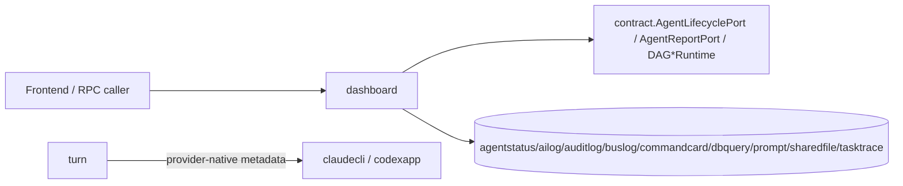
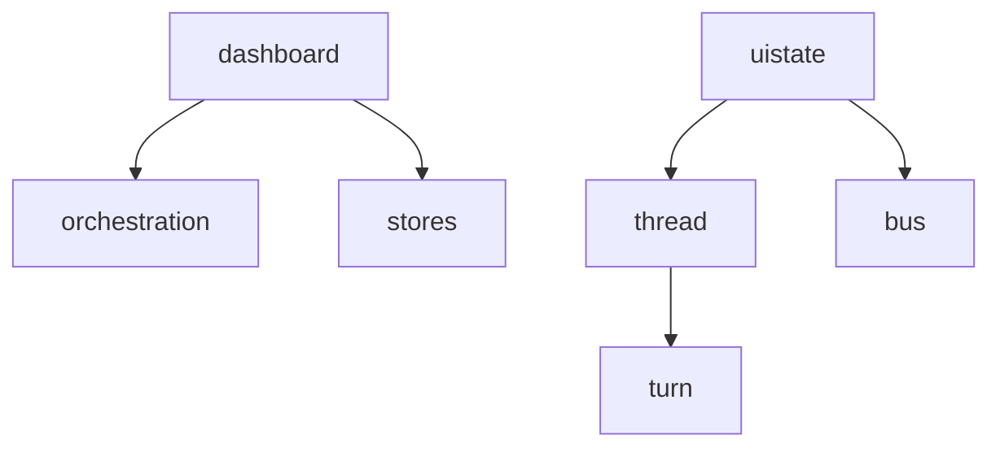
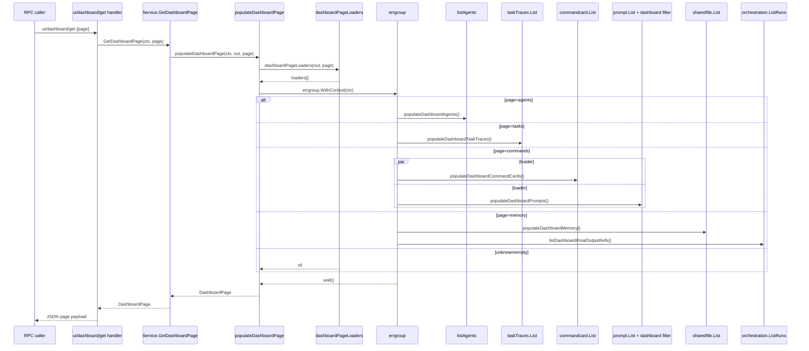
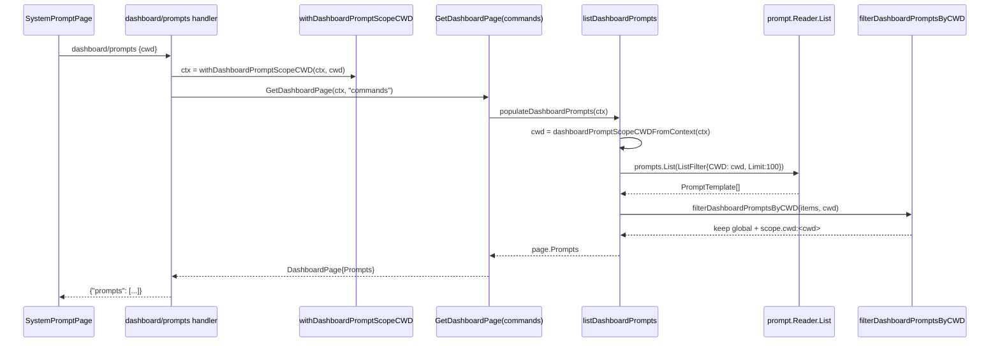
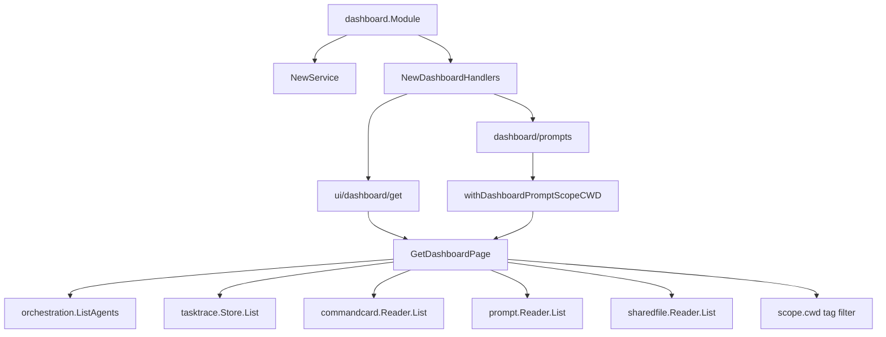

# 07A 业务模块层代码地图（读侧）

> 范围：`internal/module/dashboard/`，以及旧 lspgui 模块和 provider-native skill 能力的现状核对。
> 关联入口：[07-module.md](07-module.md) / [07-module-write.md](07-module-write.md)。

---

## 1. 读侧总览

读侧模块只做两类事：

1. **聚合已有只读数据**：`dashboard` 把 orchestration + stores 拼成页面化查询面。
2. **透传 provider-native skill 元数据**：thread/start 可携带 provider-native 选择元数据，但本地 V3 不扫描、写入或 hydrate skill 正文。

### 1.1 跨卷一致性备忘

- prompt 不再维护独立数字 freeze；`internal/module/prompt/` 的生产文件数由下面的机器计数声明生成到 `ai-index.json.counts`。统一冻结真值位于 `internal/archtest/freeze_baseline.json`。
  <!-- codemap-count path="internal/module/prompt" kind="go-files" -->
- 旧 prompt skill-catalog 注入链已退出生产路径；prompt 不再读取本地 skill catalog 或 canonical skill，正文/目录发现由 provider-native runtime 负责。
- 旧 lspgui 模块当前在仓内不存在；旧文档若仍把它写成真实包，需要按代码真值纠偏。

### 1.2 模块间主线关系（补）

- `dashboard` 站在 UI / RPC 查询面，向下只聚合 agent 生命周期读端口、report 读端口、DAG runtime 窄端口和 stores，本身不持有技能内容。
- `turn` 只透传 provider-native skill 选择元数据；不执行本地目录扫描、canonical lookup 或正文 hydration，`toolbridge` 也不暴露 `skill__*` 动态生产工具。
- `uistate` 虽不在本卷展开，但它和 `thread` / `bus` 的 projection 链一起构成 dashboard 之外的另一条读侧 UI 面。

### 1.3 依赖图

---

## 2. dashboard（仪表盘读模型）

### 2.1 角色与边界

`dashboard` 是纯查询聚合层：

- **Fx 装配**：`module.go:19-54`
  - 注入 `dashboard.OrchestrationReader`、`dashboard.OrchestrationReportReader` 与 DAG runtime 窄端口
  - 注入 `agentstatus / ailog / auditlog / buslog / commandcard / dbquery / prompt / sharedfile / systemlog / tasktrace`
  - `fx.Provide(NewDashboardHandlers)` 暴露 RPC
  - **RPC 面**：`rpc.go:155-270`
  - 页面聚合：`ui/dashboard/get`
  - 细分读取：`dashboard/{agentStatus,taskTraces,commandCards,prompts,sharedFiles,agent/detail,system/info,query,aiLogs,auditLogs,busLogs,dags,dagDetail,dagRuns,logs}`
- **服务核心**：`service.go:35-340`
  - `GetDashboardPage` / `GetAgentDetail` / `GetLogs` / `Query`
  - `GetAgentDetail` 里用 `errgroup` 并发 `Snapshot + GetReport`
- **页内装配**：`ui_page.go:17-340`
  - `DashboardPage` 聚合 `Agents/DAGs/TaskTraces/CommandCards/Prompts/Memory/FinalOutputRefs`
  - `commands` 页是唯一多 loader 并发页（`commandCards + prompts`）
  - `memory` 页在 sharedfile 列表外额外提取近期 DAG run 的 file 型 `metadata.final_output`，只作为高亮/筛选索引

### 2.2 `ui/dashboard/get` 分发链

`ui/dashboard/get` 只是薄 RPC：`rpc.go:84-86` 直接进 `svc.GetDashboardPage(ctx, p.Page)`，真正的页面分发都在 `ui_page.go`。

### 2.3 页面到数据源映射

| 页面 | loader | 真正数据源 | 备注 |
|---|---|---|---|
| `agents` | `populateDashboardAgents` | `orchestration.ListAgents` | `service.go:listAgents` |
| `tasks` | `populateDashboardTaskTraces` | `tasktrace.Store.List` | 固定 `Limit=100` |
| `commands` | `populateDashboardCommandCards` + `populateDashboardPrompts` | `commandcard.Reader.List` + `prompt.Reader.List` | 两路并发 |
| `memory` | `populateDashboardMemory` | `sharedfile.Reader.List` + `orchestration.ListDAGs/ListRuns` | sharedfile 固定 `Limit=500`；`FinalOutputRefs` 只扫最近 20 个 DAG、每 DAG 最近 3 个 run |

补充：

- `dashboard/commandCards` 只是 `GetDashboardPage("commands")` 后取 `page.CommandCards`。
- `dashboard/prompts` **不是**简单的 page-field wrapper：`rpc.go:102-108` 会先写入 `withDashboardPromptScopeCWD(ctx, p.Cwd)`，再返回 `page.Prompts`。
- `dashboard/sharedFiles` 只是 `GetDashboardPage("memory")` 后取 `page.Memory`，返回 key 为 `files`；`finalOutputRefs` 只在 `ui/dashboard/get?page=memory` 的页面 payload 暴露。

### 2.4 `dashboard/prompts` 的 `{cwd}` 过滤接线

这条链是 p20.15 补通的重点，当前 prod caller 已由 `xref(references)` 核实：

- `service.go:86-91` `withDashboardPromptScopeCWD(ctx, cwd)`
- **prod callers 现有 2 个**：`rpc.go:85-87`（`ui/dashboard/get`）、`rpc.go:102-108`（`dashboard/prompts`）
- 测试 caller 见 `service_test.go:62`

关键细节：

1. **`dashboard/prompts` handler 已不再走旧 `dashboardPageField("commands", ...)` 包装**：`rpc.go:102-108` 直接返回 `{"prompts": page.Prompts}`。
2. **ctx 传递链不是测试专用 helper，而是三条读侧入口共享的 prod 入口**：`uiDashboardGetParams{Cwd}` / `dashboardPromptsParams{Cwd}` → `withDashboardPromptScopeCWD` → `dashboardPromptScopeCWDFromContext`。
3. **最终生效过滤仍在 dashboard 模块内**：`ui_page.go:149-196`
   - 先把 `cwd` 带进 `promptstore.ListFilter`
   - 再按 tag `scope.cwd:<value>` 做 `filterDashboardPromptsByCWD`
4. **store contract 与实现存在一层“名义支持 / 实际忽略”的落差**：
   - `internal/store/prompt/contract.go:24-29` 有 `ListFilter.CWD`
   - 但 `internal/store/prompt/store.go:61-75` 当前只下发 `AgentKey/Keyword/Limit`，未真正用到 `CWD`
   - 所以今天的可见性仍由 `dashboardPromptVisibleForCWD()` 控制，而不是 prompt store SQL 过滤
5. 测试锚点：`dashboard/service_test.go:36-126` 已覆盖 `repo-a/repo-b` 作用域与 `prompts` 顶层 key。

### 2.5 其它查询面

- **Agent 详情**：`service.go:114-158`
  - `orchestration.Snapshot` 与 `orchestration.GetReport` 并发
  - `LastReport` 以 `GetReport` 结果优先，缺失时回退 snapshot 内缓存
- **统一日志**：`service.go:173-198` + `logs.go`
  - `resolveLogSource` 把 `all/system/ai` 归一成组合读取模式
  - `appendSystemLogs` / `appendAILogs` 合流后统一排序与裁剪
- **DAG 查询**：`rpc.go:132-136` / `detail.go`
  - `dashboard/dags` 与 `dashboard/dagDetail` 透传 `contract.DAGRuntime` 的 list/detail 能力
  - `dashboard/dagRuns` 走 `ListDAGRuns()`，内部 clamp limit 后调用 `orchestration.ListRuns`（`detail.go:61-80`, `rpc.go:260-266`）
- **final_output 索引**：`ui_page.go:250-340`
  - `listDashboardFinalOutputRefs()` 先取最近 DAG，再并发取每个 DAG 最近 run，解析 `run.metadata.final_output`
  - 只接收 `kind=file` 或未显式 kind 但有 `path/sharedfile.path` 的输出；text/json 最终产物留 DAG detail 展示，不进入 Shared Files 文件筛选
  - enrichment 错误不阻断 memory page：`populateDashboardMemory()` 对 refErr 静默降级为空列表（`ui_page.go:163-172`）
- **任意 DB 查询**：`rpc.go:120-122` → `service.Query()` → `dbquery.Store.Query`

### 2.6 依赖图

### 2.7 文件地图

| 文件 | 作用 |
|---|---|
| `module.go` | Fx 注入 orchestration / stores，并提供 RPC handlers；不装配本地 skill module。 |
| `rpc.go` | `ui/dashboard/get` 与各细分 `dashboard/*` 路由。 |
| `service.go` | `GetDashboard` / `GetAgentDetail` / `GetLogs` / `Query` / cwd-scope ctx helper。 |
| `ui_page.go` | `DashboardPage`、loader switch、页内并发装配、prompt tag 过滤。 |
| `detail.go` | DAG list/detail/run-list 与 Agent turn history 辅助逻辑。 |
| `logs.go` / `ai_logs.go` / `factory.go` | 日志统一包装、过滤与 DTO 组装。 |
| `agent_status.go` / `types.go` / `contract.go` | DTO 与查询接口定义。 |

---

## 3. lspgui（历史章节，当前代码缺席）

### 3.1 当前代码真值

当前仓库已删除旧 lspgui 子包：

- `find internal/module -maxdepth 2 -type d | grep lsp` → 空
- `grep path=. query="package lspgui"` → 0 命中
- `grep path=. query="lsp/gui_" glob="**/*.go"` → 0 命中

### 3.2 对 codemap 的影响

- 旧版 `07-module.md` 把 `lspgui` 写成真实存在的 GUI-LSP 包，现已与代码失真。
- 本次拆卷后只保留 **现状说明**，不再捏造文件地图 / RPC 列表 / stub 能力。
- 若未来重新引入该包，应在本节补回：`module.go / rpc.go / service.go / stubs.go` 等真实锚点后再展开。

---

## 4. Provider-native skill metadata（本地模块已移除）

V3 已物理移除本地 skill module、store adapter、host/UI SkillsPage 与对应 RPC。技能正文、目录扫描、写入、冲突解决和动态 `skill__*` 工具不再由桌面业务图提供；provider 通过自己的 native capability 发现和调用技能。thread/start 只保留显式选择元数据透传，不读取 canonical 正文，也不执行本地 hydration 或自动匹配。

### 4.1 线程启动元数据

`internal/module/thread/rpc_types.go` 仍接受 `selectedSkills` / `selectedSkillRefs` / `manualSkillSelection` 作为 provider-native 选择元数据，并在 `internal/module/thread/rpc.go` 折叠为 `StartRequest.LaunchSkill*` 字段。字段仅用于审计、诊断和 provider 传输：

- 不扫描 `.agents/skills` 或其他本地目录；
- 不调用旧 catalog/list、resolve 或 hydrate 服务；
- 不把技能正文拼进 prompt snapshot；
- 含有需要正文 hydration 的引用时，返回显式 provider capability unsupported。

### 4.2 Provider / toolbridge 边界

- `internal/provider/claudecli/` 与 `internal/provider/codexapp/` 负责各自 provider-native skill capability；桌面只传递显式元数据，不持有 provider 内容副本。
- `internal/module/prompt/dynamic.go` 只识别 provider 返回的 skill capability 名称，用于 guidance 文案，不做本地目录发现。
- `internal/platform/toolbridge/handler_host_tools.go` 对残留 `skill__*` 调用 fail closed，返回 unsupported，且不会触达 MCP peer。
- `thread/skills/list` 仍可作为低频 provider-native `/skills` 命令透传；它不读取本地 skill store，也不恢复已删除的 Skills 页面。

### 4.3 Dashboard 与 UI 影响

`internal/module/dashboard/` 的 `DashboardPage` 不再包含 Skills 字段，`dashboard/skills` 路由和前端 SkillsPage 已删除。前端仅保留 provider-native skill metadata（例如启动请求的 selected refs 和聊天引用）所需 wire 字段；不存在本地技能列表或编辑入口。

`ui/dashboard/get` 仍并发聚合 agents、tasks、commands、prompts、memory 等页面；`dashboard/prompts` 的 `cwd` 作用域链保持不变，见本卷 §2.4。

### 4.4 事件与兼容性

本地 `SkillsChanged` DTO、事件总线发布和 `skill/requestApproval` approval alias 已移除。provider-native approval 仍走通用 command/tool approval contract，不再依赖 skill-specific event/method。

### 4.5 验证矩阵

| 面 | 验证 | 预期 |
|---|---|---|
| app Fx 图 | `go test ./internal/app -run 'TestAppModuleGraph|TestAppRoot' -count=1` | 不装配本地 skill module/adapter |
| turn | `go test ./internal/module/turn -count=1` | 无 canonical lookup/hydration/auto-match |
| dashboard | `go test ./internal/module/dashboard -count=1` | 无 Skills page/route 或 local scanner |
| toolbridge | `go test ./internal/platform/toolbridge -count=1` | `skill__*` 调用显式 unsupported，MCP callback 不触发 |
| frontend | `npm run lint && npm run build` | SkillsPage/RPC 入口不存在，provider metadata 编译通过 |
| map/contract | `make project-map-check && make capcontract-check` | 生成地图与 capability manifest 无 deleted skill symbols |

## 5. 本卷需要牢记的代码真值

1. `dashboard/prompts` 的 `{cwd}` 作用域已经接到 **prod handler**；`withDashboardPromptScopeCWD` 不再只是测试 helper。
2. `promptstore.ListFilter.CWD` 只在 contract 层露出；当前 store 实现未真正下推过滤，实际筛选仍在 `dashboard/ui_page.go`。
3. thread/start 仅透传 provider-native skill 选择元数据；本地 skill/list、skill/expand、catalog、resolve 和 hydration 链已删除。
4. provider runtime 直接负责自己的 native skill capability；V3 桌面不再拥有本地技能正文存储或动态 `skill__*` 工具。
5. `lspgui` 在当前仓内 **无源码目录**；旧 codemap 对它的实现级描述已过时。

---

## 6. 测试入口 + how-to 补遗

### 6.1 测试入口

> freeze 口径：本卷直接涉及的 `dashboard / uistate` 当前无独立 freeze 项；相邻 `prompt` 文件计数读取 §1.1 声明对应的 `ai-index.json.counts` 指标。

| 包 | 测试文件 | 核心 Test* | 锁定点 |
|---|---|---|---|
| `dashboard` | `service_test.go` | `TestGetDashboardPageFiltersPromptsByScopedCWD` / `TestDashboardPromptsHandlerScopesByCWDAndReturnsPromptsKey` | 锁定 `dashboard/prompts` 的 `{cwd}` 透传、`prompts` 顶层 key 与 scope 过滤。 |
| `uistate` | `phase2_stats_patch_pending_test.go` / `sidebar_test.go` | `TestActivityStats_CommandIncrementsCommands` / `TestProjectionSubscriptionsUpdateSidebarFromLifecycleAndOutputEvents` | 锁定 sidebar / activity stats 的 projection 读侧更新。 |
| `uistate/timeline` | `timeline/timeline_test.go` | `TestAppendAndGetByThread` | 锁定 timeline 读模型 append/get 基线。 |

### 6.2 how-to 三条

1. **dashboard 页**
   - 触发：新增只读聚合 page / tab。
   - 步骤：`DashboardPage` 扩字段 → `dashboardPageLoaders@dashboard/ui_page.go:66-92` 挂 loader → `NewDashboardHandlers@dashboard/rpc.go:83-150` 接 `ui/dashboard/get` 或专门 `dashboard/*` 路由。
   - 验证：优先补 `dashboard/service_test.go`。
2. **provider-native skill metadata**
   - 触发：thread/start 需要透传 provider 已选择的 skill 元数据。
   - 步骤：仅扩展 `internal/module/thread/rpc_types.go` 的 metadata 字段和 `internal/module/thread/rpc.go` 的 provider 传输映射；不得重新引入本地目录扫描、正文 hydration、Skills 页面或 `skill/*` RPC。
   - 验证：`go test ./internal/module/thread -count=1`，并覆盖非支持正文引用返回 `ErrProviderNativeCapabilityUnsupported`。
3. **uistate**
   - 触发：线程 / 回合事件要进 sidebar、timeline 或 stats。
   - 步骤：先有事件 emit，再由 `registerProjections@uistate/module.go:46-66` 挂生命周期，最后在 `registerProjectionSubscriptions@uistate/projector.go:17-60` 订阅并落读模型。
   - 验证：`sidebar_test.go` / `timeline/timeline_test.go`。
