# S0 dependency map (planning-only)

> Offline planning skeleton only. This artifact is non-authorizing: it never grants approval, GO, release, enablement, or runtime execution permission.
> The registry `baseline_commit` identifies the historical source-spec snapshot; it is distinct from the active worktree HEAD used for local revalidation.

## Derived counts

| Measure | Count |
| --- | ---: |
| Nodes | 28 |
| Spec nodes | 14 |
| Gate nodes | 14 |
| Edges | 63 |
| Blockers | 18 |
| Cross-task requirements | 8 |
| Cross-task RED planned refs | 8 |
| Cross-task GREEN planned refs | 8 |
| Cross-task Guard planned refs | 8 |
| RED evidence entries | 18 |
| GREEN evidence entries | 18 |
| Guard evidence entries | 18 |

> RED/GREEN/Guard counts are planned or observed workspace references only; they are non-authoritative and do not indicate blocker closure or release approval.

## Child spec execution index (planning-only)

> Owner, prerequisites, ancestor gates, entry/exit criteria, commands, and blocker IDs are review metadata only. Command output remains LOCAL_NON_AUTHORITATIVE/NOT_VERIFIED; no row grants runtime or release permission.

| Spec | Owner | Prerequisites | Ancestor gates | Evidence classification | Blockers |
| --- | --- | --- | --- | --- | --- |
| A2A | A2A gateway owner for remote wire/auth/egress; local owners retain local facts and authorization | ID, CONTENT, RESOURCE, OUT, TRUST, ROOM | VERIFY_S, ROLLOUT_S | planning_only; external remote evidence required and currently unverified | B13 |
| BRIDGE | per-provider bridge owner with an independently fenced profile for each CLI | CTL, PROBE, ID, CONTENT, RESOURCE, OUT, TRUST | VERIFY_S, ROLLOUT_S | planning_only; external provider/process evidence required and currently unverified | B05, B06, B15 |
| CONTENT | ContentOwner for encrypted objects, references, tombstones, and erasure state | ID | VERIFY_S, ROLLOUT_S | planning_only; local evidence is non-authoritative | B13 |
| CTL | standalone control-plane owner for server sessions, leases, and native-agent RPC | VERIFY_S, ROLLOUT_S | VERIFY_S, ROLLOUT_S | planning_only; local transport evidence is non-authoritative | B01, B02, B03, B05, B11, B15, B16, B17 |
| ID | IdentityRepository and EventStore as the sole identity and append owners | TRUST | VERIFY_S, ROLLOUT_S | planning_only; local evidence is non-authoritative | B01, B02, B03, B08, B10, B16, B17, B18 |
| OUT | CommandOwner with SecurityDomainSequencer and RecoveryCustodyOwner for command facts and receipts | ID, CONTENT, RESOURCE | VERIFY_S, ROLLOUT_S | planning_only; local evidence is non-authoritative | B08, B09, B12 |
| PROBE | Provider conformance owner with independent per-provider evidence scope | VERIFY_S, ROLLOUT_S | VERIFY_S, ROLLOUT_S | planning_only; external provider evidence required and currently unverified | B04, B15 |
| RESOURCE | ResourcePolicyRepository and AdmissionRepository as the sole policy and reservation writers | ID | VERIFY_S, ROLLOUT_S | planning_only; local evidence is non-authoritative | B04, B11, B12, B17 |
| ROLLOUT | independent rollout owner with database, recovery-custody, and runtime-effect owner joins | none | none | planning_only; authoritative rollout evidence is required and absent | B06, B10, B18 |
| ROOM | Room domain owner for membership snapshots, fan-out inventory, receipts, close, and recovery | ID, CONTENT, RESOURCE, OUT, TRUST | VERIFY_S, ROLLOUT_S | planning_only; no direct historical blocker owner, cross-task evidence remains unverified | none |
| TOOLS | tool-surface/rollout owner with the generated registry as schema source of truth | CTL, PROBE, ID, RESOURCE, OUT, TRUST, ROOM, BRIDGE | VERIFY_S, ROLLOUT_S | planning_only; local mapper evidence is non-authoritative | B05, B06, B07, B14 |
| TRUST | TrustPolicyOwner with ControllerSignatureOwner for the outer envelope | VERIFY_S, ROLLOUT_S | VERIFY_S, ROLLOUT_S | planning_only; local evidence is non-authoritative | B01, B02, B03, B04, B06, B07, B09, B12, B13, B14, B15, B16, B17 |
| UI | host UI projection owner as a read-only consumer of canonical event, content, room, and tool owners | ID, CONTENT, RESOURCE, OUT, ROOM, TOOLS | VERIFY_S, ROLLOUT_S | planning_only; local UI evidence is non-authoritative | B07, B13 |
| VERIFY | trusted verification/evidence owner with independent assignment and decision evaluators | none | none | planning_only; authoritative release evidence is required and absent | B06, B07, B08, B09, B10, B11, B12, B13, B14, B16, B18 |
## Cross-task requirements (planning-only)

> These 8 rows define acceptance planning for cross-task delivery. They do not register tools, grant capability, or enable runtime. `legacy send_message` is explicitly not a canonical surface; canonical rows use only `unified_v2` or `room`.

| ID | Capability | Canonical surface | Owners | Depends on | Ancestor gates | Status | RED refs | GREEN refs | Guard refs |
| --- | --- | --- | --- | --- | --- | --- | --- | --- | --- |
| CT_CURSOR_RESUME | cursor_resume | unified_v2 | ID, TOOLS, UI, VERIFY | ID, TOOLS, UI, VERIFY | VERIFY_S, ROLLOUT_S, DOMAIN_DONE, VERIFY_DONE, PRECANARY_DONE | pending | docs/work/plans/orch-subagent-upgrade/cross-task-requirements.md | docs/work/plans/orch-subagent-upgrade/cross-task-requirements.md | docs/work/plans/orch-subagent-upgrade/cross-task-requirements.md |
| CT_DELIVERY_UNION | direct_peer_delivery_union | unified_v2 | ID, CONTENT, RESOURCE, OUT, BRIDGE, TOOLS | ID, CONTENT, RESOURCE, OUT, BRIDGE, TOOLS | VERIFY_S, ROLLOUT_S, DOMAIN_DONE, VERIFY_DONE, PRECANARY_DONE | needs_revalidation | docs/work/plans/orch-subagent-upgrade/cross-task-requirements.md | docs/work/plans/orch-subagent-upgrade/cross-task-requirements.md | docs/work/plans/orch-subagent-upgrade/cross-task-requirements.md |
| CT_GRANT_SPLIT | strict_discover_read_send_grant | unified_v2 | TRUST, ID, TOOLS, VERIFY | TRUST, ID, TOOLS, VERIFY | VERIFY_S, ROLLOUT_S, DOMAIN_DONE, VERIFY_DONE, PRECANARY_DONE | pending | docs/work/plans/orch-subagent-upgrade/cross-task-requirements.md | docs/work/plans/orch-subagent-upgrade/cross-task-requirements.md | docs/work/plans/orch-subagent-upgrade/cross-task-requirements.md |
| CT_IDEMPOTENCY | idempotency | unified_v2 | ID, OUT, TOOLS, VERIFY | ID, OUT, TOOLS, VERIFY | VERIFY_S, ROLLOUT_S, DOMAIN_DONE, VERIFY_DONE, PRECANARY_DONE | needs_revalidation | docs/work/plans/orch-subagent-upgrade/cross-task-requirements.md | docs/work/plans/orch-subagent-upgrade/cross-task-requirements.md | docs/work/plans/orch-subagent-upgrade/cross-task-requirements.md |
| CT_MESSAGE_REPLY_ASSOCIATION | message_reply_association | unified_v2 | ID, CONTENT, OUT, TOOLS, UI | ID, CONTENT, OUT, TOOLS, UI | VERIFY_S, ROLLOUT_S, DOMAIN_DONE, VERIFY_DONE, PRECANARY_DONE | pending | docs/work/plans/orch-subagent-upgrade/cross-task-requirements.md | docs/work/plans/orch-subagent-upgrade/cross-task-requirements.md | docs/work/plans/orch-subagent-upgrade/cross-task-requirements.md |
| CT_ROOM_NO_ESCALATION | room_no_escalation | room | TRUST, ID, CONTENT, RESOURCE, OUT, ROOM | TRUST, ID, CONTENT, RESOURCE, OUT, ROOM | VERIFY_S, ROLLOUT_S, DOMAIN_DONE, VERIFY_DONE, PRECANARY_DONE | needs_revalidation | docs/work/plans/orch-subagent-upgrade/cross-task-requirements.md | docs/work/plans/orch-subagent-upgrade/cross-task-requirements.md | docs/work/plans/orch-subagent-upgrade/cross-task-requirements.md |
| CT_UNAUTHORIZED_ZERO_EFFECT | unauthorized_zero_side_effect | unified_v2 | TRUST, ID, CONTENT, RESOURCE, OUT, TOOLS, ROOM, VERIFY | TRUST, ID, CONTENT, RESOURCE, OUT, TOOLS, ROOM, VERIFY | VERIFY_S, ROLLOUT_S, DOMAIN_DONE, VERIFY_DONE, PRECANARY_DONE | needs_revalidation | docs/work/plans/orch-subagent-upgrade/cross-task-requirements.md | docs/work/plans/orch-subagent-upgrade/cross-task-requirements.md | docs/work/plans/orch-subagent-upgrade/cross-task-requirements.md |
| CT_UNKNOWN_OUTCOME | unknown_outcome | unified_v2 | ID, RESOURCE, OUT, TOOLS, VERIFY | ID, RESOURCE, OUT, TOOLS, VERIFY | VERIFY_S, ROLLOUT_S, DOMAIN_DONE, VERIFY_DONE, PRECANARY_DONE | pending | docs/work/plans/orch-subagent-upgrade/cross-task-requirements.md | docs/work/plans/orch-subagent-upgrade/cross-task-requirements.md | docs/work/plans/orch-subagent-upgrade/cross-task-requirements.md |

## Dependency graph

```mermaid
flowchart LR
    A2A["A2A — 跨实例 A2A 网关 (spec, draft)"]
    BRIDGE["BRIDGE — 各提供方 CLI 原生桥接 (spec, draft)"]
    CANARY_100_ATTEST["CANARY_100_ATTEST — 100%及24小时后观测证明 (gate, pending)"]
    CANARY_100_LEASE["CANARY_100_LEASE — 100%阶段准入 (gate, pending)"]
    CANARY_25_ATTEST["CANARY_25_ATTEST — 25%观测窗口证明 (gate, pending)"]
    CANARY_25_LEASE["CANARY_25_LEASE — 25%阶段准入 (gate, pending)"]
    CANARY_5_ATTEST["CANARY_5_ATTEST — 5%观测窗口证明 (gate, pending)"]
    CANARY_5_LEASE["CANARY_5_LEASE — 5%阶段准入 (gate, pending)"]
    CONTENT["CONTENT — 内容生命周期与加密擦除 (spec, draft)"]
    CTL["CTL — 控制通道与原生任务 RPC (spec, draft)"]
    DOMAIN_DONE["DOMAIN_DONE — 所有适用领域规格获批 (gate, pending)"]
    ENABLE["ENABLE — GA稳定运行许可 (gate, pending)"]
    FINAL_COMMIT["FINAL_COMMIT — 证据与启用记录原子提交 (gate, pending)"]
    FINAL_DECISION["FINAL_DECISION — GA认证裁决 (gate, pending)"]
    ID["ID — 任务身份与事件存储 (spec, draft)"]
    OUT["OUT — 持久命令与事务发件箱 (spec, draft)"]
    PRECANARY_DONE["PRECANARY_DONE — 混合版本迁移恢复回滚证明完成 (gate, pending)"]
    PROBE["PROBE — 官方 CLI 能力探测 (spec, draft)"]
    RESOURCE["RESOURCE — 持久资源准入与预算 (spec, draft)"]
    ROLLOUT["ROLLOUT — 跨进程升级与回滚 (spec, draft)"]
    ROLLOUT_S["ROLLOUT_S — 升级回滚骨架获批 (gate, pending)"]
    ROOM["ROOM — 协作房间授权与流控 (spec, draft)"]
    TOOLS["TOOLS — 版本化工具面迁移 (spec, draft)"]
    TRUST["TRUST — 输出信任与提示词边界 (spec, draft)"]
    UI["UI — 任务与事件 UI 投影 (spec, draft)"]
    VERIFY["VERIFY — 机器验证与发布证据 (spec, draft)"]
    VERIFY_DONE["VERIFY_DONE — 运行证明与验证裁决完成 (gate, pending)"]
    VERIFY_S["VERIFY_S — 验证骨架获批 (gate, pending)"]
    A2A -->|requires| DOMAIN_DONE
    BRIDGE -->|requires| DOMAIN_DONE
    BRIDGE -->|provider_enable:codex,claude,agy,grok| TOOLS
    CANARY_100_ATTEST -->|requires| FINAL_DECISION
    CANARY_100_LEASE -->|requires| CANARY_100_ATTEST
    CANARY_25_ATTEST -->|requires| CANARY_100_LEASE
    CANARY_25_LEASE -->|requires| CANARY_25_ATTEST
    CANARY_5_ATTEST -->|requires| CANARY_25_LEASE
    CANARY_5_LEASE -->|requires| CANARY_5_ATTEST
    CONTENT -->|requires| A2A
    CONTENT -->|requires| BRIDGE
    CONTENT -->|requires| OUT
    CONTENT -->|requires| ROOM
    CONTENT -->|requires| UI
    CTL -->|requires| BRIDGE
    CTL -->|requires| TOOLS
    DOMAIN_DONE -->|requires| PRECANARY_DONE
    DOMAIN_DONE -->|requires| VERIFY_DONE
    FINAL_COMMIT -->|requires| ENABLE
    FINAL_DECISION -->|requires| FINAL_COMMIT
    ID -->|requires| A2A
    ID -->|requires| BRIDGE
    ID -->|requires| CONTENT
    ID -->|requires| OUT
    ID -->|requires| RESOURCE
    ID -->|requires| ROOM
    ID -->|requires| TOOLS
    ID -->|requires| UI
    OUT -->|requires| A2A
    OUT -->|requires| BRIDGE
    OUT -->|requires| ROOM
    OUT -->|requires| TOOLS
    OUT -->|requires| UI
    PRECANARY_DONE -->|requires| CANARY_5_LEASE
    PROBE -->|requires| BRIDGE
    PROBE -->|requires| TOOLS
    RESOURCE -->|requires| A2A
    RESOURCE -->|requires| BRIDGE
    RESOURCE -->|requires| OUT
    RESOURCE -->|requires| ROOM
    RESOURCE -->|requires| TOOLS
    RESOURCE -->|requires| UI
    ROLLOUT -->|requires| PRECANARY_DONE
    ROLLOUT -->|requires| ROLLOUT_S
    ROLLOUT_S -->|root_compatibility| CTL
    ROLLOUT_S -->|root_compatibility| PROBE
    ROLLOUT_S -->|root_compatibility| TRUST
    ROOM -->|requires| A2A
    ROOM -->|requires| TOOLS
    ROOM -->|requires| UI
    TOOLS -->|requires| UI
    TRUST -->|requires| A2A
    TRUST -->|requires| BRIDGE
    TRUST -->|requires| ID
    TRUST -->|requires| ROOM
    TRUST -->|requires| TOOLS
    UI -->|requires| DOMAIN_DONE
    VERIFY -->|requires| VERIFY_DONE
    VERIFY -->|requires| VERIFY_S
    VERIFY_DONE -->|requires| CANARY_5_LEASE
    VERIFY_S -->|root_requirement| CTL
    VERIFY_S -->|root_requirement| PROBE
    VERIFY_S -->|root_requirement| TRUST
```



## Current blockers (planning registry)

| ID | Title | Priority | Scope | Status | Source requirement | Closure requirement | Owners | Evidence refs | RED entries | GREEN entries | Guard entries |
| --- | --- | --- | --- | --- | --- | --- | --- | --- | --- | --- | --- |
| B01 | 控制通道租约冒用 | P0 | D10 Security、D03 MCP | needs_revalidation | `internal/platform/rpc/control_rpc_auth.go:30-51,83-110` 只把 ctl connection 标记为已认证；`internal/platform/mcpcontrol/handlers.go:110-152` 与 `registry.go:189-230` 从 payload 接受任意 `LeaseKey`，`factory.go:110-123`/`resolution.go:13-19` 只查 registry，未与当前 jrpc2 server 的 lease 比对。任一已注册 peer因此可冒用另一 active peer读取 context、注入 event/log/report/approval，发送 active heartbeat无限续命，或发送 disconnected主动驱逐并清 hook；hook path `handlers_hooks.go:138-172` 已展示 transport-bound lookup模式。 | 所有 ctl method先从 transport principal/current server解析自己的 LeaseKey；payload key若保留必须 constant-time exact match，不得选择目标principal。增加 peer A冒用 peer B的逐method及逐heartbeat status负测，任何 handler side effect、续租、evict、hook cleanup均为零。 | CTL, TRUST, ID | docs/superpowers/specs/2026-07-11-unified-native-subagent-control-plane-design.md | docs/work/plans/orch-subagent-upgrade/blocker-revalidation-2026-09-02.md | docs/work/plans/orch-subagent-upgrade/verification-notes.md | scripts/orch_upgrade_gate_guard_test.go |
| B02 | 连接重复注册 | P0 | D03 MCP、D10 Security、D19 SSOT | needs_revalidation | `control_rpc_auth.go:30-51,64-72,83-118` 只记录 authenticated bool；`registry.go:121-186` 每次 `ctl/register` 都创建 lease。同一 TCP connection 可连续注册相同或不同 instance，形成多个 active lease；`handlers_hooks.go:150-172` 按 server遍历 Go map取“首个”lease，使身份、fanout和 disconnect cleanup不确定。 | 首次 register原子建立唯一 server->LeaseKey索引并冻结 connection principal；同 connection第二次 register无论instance/capability是否相同都以稳定 `already_registered` 在索引副作用前拒绝。相同/不同instance重复注册、hook lookup、fanout、disconnect/reconnect race测试必须始终 one connection/one principal/one lease。 | CTL, ID, TRUST | docs/superpowers/specs/2026-07-11-unified-native-subagent-control-plane-design.md | docs/work/plans/orch-subagent-upgrade/blocker-revalidation-2026-09-02.md | docs/work/plans/orch-subagent-upgrade/verification-notes.md | scripts/orch_upgrade_gate_guard_test.go |
| B03 | 代际恢复回退 | P0 | D10 Security、D19 SSOT | needs_revalidation | `bootstrap/lifecycle.go:81-83` 发送 `ResumeFromGeneration`，但 `mcpcontrol/registry_support.go:22-44` 未校验；`registry.go:133-165` 只依据内存 `latestByInstance` 递增，而 disconnect `registry.go:306-318` 会删除它。相同 instance 重连可再次得到 generation 1，使旧 LeaseKey 与新连接碰撞、fence 失效。 | generation owner 保留进程期 monotonic tombstone，注册使用 `max(last_seen,resume_from)+1` 并拒绝回退/冲突；host 重启无法证明连续性时必须换 boot/instance epoch。增加 disconnect/reconnect、stale resume、并发 register 与 host-restart epoch 负测。 | ID, CTL, TRUST | docs/superpowers/specs/2026-07-11-unified-native-subagent-control-plane-design.md | docs/work/plans/orch-subagent-upgrade/blocker-revalidation-2026-09-02.md | docs/work/plans/orch-subagent-upgrade/verification-notes.md | scripts/orch_upgrade_gate_guard_test.go |
| B04 | PID弱信号误杀 | P1 | D10 Security、D05 Provider | needs_revalidation | `internal/provider/codexapp/module.go:341-363` 在 identity-aware PID registry cleanup 后继续 legacy sweep；`module.go:460-504` 与 `orphan_sweeper.go:9-30,51-106,149-170` 只按 binary/PPID 等弱信号执行 kill，没有在 TERM/KILL 前复核 start token + executable identity。PID reuse 或合法 detached instance 可被误杀。 | legacy scan 仅 discovery/告警；若仍允许 kill，采集 provenance/process identity，并在 TERM 与 KILL 两次复核。增加 PID reuse、同名合法 detached 进程、identity changed between TERM/KILL 的负测。 | RESOURCE, TRUST, PROBE | docs/superpowers/specs/2026-07-11-unified-native-subagent-control-plane-design.md | docs/work/plans/orch-subagent-upgrade/blocker-revalidation-2026-09-02.md | docs/work/plans/orch-subagent-upgrade/verification-notes.md | scripts/orch_upgrade_gate_guard_test.go |
| B05 | 控制面数据面混道 | P1 | D01 Architecture、D03 MCP | needs_revalidation | 上述 reverse `tools/list\|tools/call` 把 tool data plane 混入 ctl lifecycle channel，与 accepted 双通道契约冲突，也会混淆 request-id、cancel、auth/fence 与 backpressure registry。 | 首选恢复严格双通道，通过受管 stdio/data-plane connection 调用工具；若确需 reverse proxy，必须先修订 accepted contract，并使用独立版本化 `ctl/tool-proxy/*`、独立 request/cancel registry 与 auth/fence，不得伪装为标准 MCP `tools/*`。增加 contract/archtest 阻止回归。 | CTL, TOOLS, BRIDGE | docs/superpowers/specs/2026-07-11-unified-native-subagent-control-plane-design.md | docs/work/plans/orch-subagent-upgrade/blocker-revalidation-2026-09-02.md | docs/work/plans/orch-subagent-upgrade/verification-notes.md | scripts/orch_upgrade_gate_guard_test.go |
| B06 | 运行时发现冒充清单 | P0 | D01 Architecture、D03 MCP、D13 Release、D17 Field Guard、D19 SSOT | needs_revalidation | accepted lifecycle ADR允许HTTP、stdio、peer聚合与proxy可信discovery；当前 `internal/platform/toolbridge/handler_peer_decode.go:54-75,119-145,178-230`/`stdio_mcp_client.go:137-143` 的 `PrepareCodexToolSurface`会启动stdio MCP、调用data-plane `tools/list`并backfill，`internal/module/mcp_server/service.go:222-265` 的HTTP路径也会discover/backfill，ctl reverse只是其中一条且违反双通道。真正缺口是这些运行时结果都不是与binary/profile/hash绑定、签名/versioned的canonical build artifact；strict `unified_v2`若在policy前依赖任一runtime `tools/list`建立canonical identity，fresh workspace或new-tool upgrade仍受可变运行时发现结果支配，无法形成immutable profile bootstrap。 | 构建从唯一registry产出non-authorizing signed canonical manifest，host安装/升级期事务性seed/reconcile后签policy，sidecar才完成join/admission。迁移测试证明accepted legacy stdio/HTTP discovery仍可用；strict profile缺artifact时必须在sidecar启动及任何runtime `tools/list`前fail closed。另锁定空表、新工具、artifact tamper、missing、mixed binary/profile、ctl reverse disabled与signed artifact成功seed。 | TOOLS, BRIDGE, TRUST, VERIFY, ROLLOUT | docs/superpowers/specs/2026-07-11-unified-native-subagent-control-plane-design.md | docs/work/plans/orch-subagent-upgrade/blocker-revalidation-2026-09-02.md | docs/work/plans/orch-subagent-upgrade/verification-notes.md | scripts/orch_upgrade_gate_guard_test.go |
| B07 | 工具目录越权成真值 | P1 | D03 MCP、D09 Frontend、D17 Field Guard、D19 SSOT | needs_revalidation | `internal/app/tool_catalog_rpc.go:13-58` 已把 `toolbridge/tools/list` 注册进production RPC；`internal/platform/toolbridge/handler_host_tools.go:130-199` 又从live host/peer discovery与lifecycle backfill生成仅含 `serverName/toolName/displayName/description/enabled/disabledReason` 的UX目录，不返回workspace effective-snapshot revision/hash、canonical manifest/tool schema digest或source cursor。该投影若被strict profile、安装/升级或selected-tool binding当成canonical identity，会把运行时发现结果重新变成可授权SSOT，并让schema/lifecycle漂移不可判定。 | 明确该RPC只读且non-authorizing，只能从已验证manifest派生的workspace effective snapshot单向投影；response绑定workspace/snapshot/lifecycle revision、`tool_manifest_hash`、source cursor与每tool canonical id/schema digest，未知/缺失/重复字段fail-first。任何call仍独立按current policy/direct deny校验，RPC不得触发discovery backfill、seed manifest或签policy；生成式producer-consumer差集与future wire-field测试锁定DTO、Go mapper、前端validator/binding及direct-call gate。 | TOOLS, UI, TRUST, VERIFY | docs/superpowers/specs/2026-07-11-unified-native-subagent-control-plane-design.md | docs/work/plans/orch-subagent-upgrade/blocker-revalidation-2026-09-02.md | docs/work/plans/orch-subagent-upgrade/verification-notes.md | scripts/orch_upgrade_gate_guard_test.go |
| B08 | 唤醒外部副作用先行 | P0 | D06 Orchestration、D10 Security、D12 Testing | needs_revalidation | `cmd/mcp-orch/orchestration/wakeup_dispatcher.go:234-274` 先执行 `LaunchAgent` 外部副作用，再调用 `MarkWakeupSent`；`internal/contract/orchestration.go:278-296` 的 `LaunchRequest` 没有 wakeup command/attempt/idempotency/receipt fence。provider 已成功但进程在 mark 前崩溃或超时后，wakeup lease 可被 reclaim 并再次 launch。 | legacy/DAG wakeup launch 必须先原子形成 canonical command intent，并复用 outbox attempt/idempotency/receipt/reconcile；未能证明第一次未执行时只能 `outcome_unknown`，不能重发。增加 provider-success -> before-mark kill/restart/reclaim 测试，外部创建计数必须为 1。 | OUT, ID, VERIFY | docs/superpowers/specs/2026-07-11-unified-native-subagent-control-plane-design.md | docs/work/plans/orch-subagent-upgrade/blocker-revalidation-2026-09-02.md | docs/work/plans/orch-subagent-upgrade/verification-notes.md | scripts/orch_upgrade_gate_guard_test.go |
| B09 | 唤醒载荷静默回退 | P1 | D02 Fail-fast、D06 Orchestration、D17 Field Guard | needs_revalidation | `wakeup_dispatcher.go:368-390` 先猜 `DownstreamWakeupPayload`，再静默回退 `LaunchRequest`；invalid JSON返回只有 target id的空请求，unknown字段又被 `json.Unmarshal`忽略。`store/taskdag/store_wakeup.go:46-63` enqueue不验证payload discriminator/schema，DB仅 `CHECK(json_valid(prompt_payload))`，因此 `{}`、`{"promt":"x"}`或mixed union可持久化并真的调用launcher。 | 引入versioned `wakeup_payload_kind/schema_version`判别联合，在enqueue与dispatch都用 `DisallowUnknownFields`等严格generated decoder；legacy只允许显式迁移，不在runtime猜schema。invalid/missing/unknown/mixed payload必须在launcher call前进入typed failed/quarantine，call count=0。 | OUT, VERIFY, TRUST | docs/superpowers/specs/2026-07-11-unified-native-subagent-control-plane-design.md | docs/work/plans/orch-subagent-upgrade/blocker-revalidation-2026-09-02.md | docs/work/plans/orch-subagent-upgrade/verification-notes.md | scripts/orch_upgrade_gate_guard_test.go |
| B10 | 旧写者越权写入 | P0 | D07 Store、D13 Release、D19 SSOT | needs_revalidation | 当前 `internal/platform/db/module.go:234-249` 与 `sqlite/migrate.go:18-151` 只打开共享 RW SQLite、执行 migration/schema gate；例如 `cmd/mcp-orch/sql/queries/task_dag_wakeup_dispatch.sql:5-32,57-65` 的 mutation 没有 DB-resident writer epoch。active-binary lease/deployment handshake 是软门，仍持 RW connection 的旧进程可在 lease 过期或 cutover 后继续写。 | 新 owner 的每次 mutation transaction 都必须 CAS `writer_epoch/deployment_fence`；旧 binary cutover 通过文件/DB写权撤销、新 DB namespace或进程终止硬隔离。增加 subprocess A(epoch N) 持连接、B bump/freeze N+1 后 A 对全部 mutation owner 写入均 `stale_writer` 且 zero rows 的生成测试。 | ROLLOUT, ID, VERIFY | docs/superpowers/specs/2026-07-11-unified-native-subagent-control-plane-design.md | docs/work/plans/orch-subagent-upgrade/blocker-revalidation-2026-09-02.md | docs/work/plans/orch-subagent-upgrade/verification-notes.md | scripts/orch_upgrade_gate_guard_test.go |
| B11 | 控制连接资源耗尽 | P1 | D10 Security、D14 Performance | needs_revalidation | `internal/platform/rpc/server.go:407-433,455-508` 对每个 control TCP accept启动goroutine并无限等待，`prepareServerOptions:629-642`没有 pre-auth connection/read deadline；`channel/split.go:44-58` 在 LF 前持续扩张 buffer，只有 UI WebSocket路径有32-slot cap。loopback任意本地进程可用idle sockets或无换行字节流耗尽fd/goroutine/内存；认证后也没有per-principal/global cap。 | listener在启动jrpc2 server/大buffer前取得process-global pre-auth slot，设置auth/register/read/frame/idle deadline与硬byte cap，认证后转入per-principal/global公平限流；timeout/超限关闭连接。增加 >cap idle、无LF slowloris/oversized frame与合法ctl heartbeat/interrupt隔离测试，结束后fd/goroutine/buffer归零。 | RESOURCE, CTL, VERIFY | docs/superpowers/specs/2026-07-11-unified-native-subagent-control-plane-design.md | docs/work/plans/orch-subagent-upgrade/blocker-revalidation-2026-09-02.md | docs/work/plans/orch-subagent-upgrade/verification-notes.md | scripts/orch_upgrade_gate_guard_test.go |
| B12 | 安全时间不统一 | P1 | D06 Orchestration、D10 Security | needs_revalidation | `cmd/mcp-orch/store/taskdag/store_wakeup.go:123-133` 用 wall clock生成 claim fence，`task_dag_wakeup_dispatch.sql:18,48-55,57-65` 又用 SQLite `strftime('now')` 决定到期/续约/terminal CAS；规格中其他 credential/lease/handle 也尚无统一 security-time owner。系统时钟回拨可把授权或 worker lease事实延长，跨进程 clock不一致会产生相反裁决。 | 增加持久 security-time high-water/clock epoch；同 boot 用 monotonic deadline，跨 boot/进程验证 wall high-water + bounded skew，不确定即 fail closed/re-auth/reprobe。注入 backward/forward jump、sleep/resume、restart与 mixed-process clock 测试。 | TRUST, RESOURCE, OUT, VERIFY | docs/superpowers/specs/2026-07-11-unified-native-subagent-control-plane-design.md | docs/work/plans/orch-subagent-upgrade/blocker-revalidation-2026-09-02.md | docs/work/plans/orch-subagent-upgrade/verification-notes.md | scripts/orch_upgrade_gate_guard_test.go |
| B13 | 不可信内容主动联网 | P1 | D09 Frontend、D10 Security | needs_revalidation | `frontend-app/src/pages/chat/markdown/MarkdownMessage.jsx:42-45` 允许任意 HTTP(S) image，`MarkdownImagePreview.jsx:46-52` 自动创建 ``，`frontend-app/src/App.test.jsx:1710-1731` 还锁定自动远程加载。provider/A2A/peer 不可信输出因此可让 WebView 对外网、loopback或私网主动请求，泄漏 IP/环境并形成 SSRF/端口探测 sink。 | 默认把 untrusted image/link/media 渲染为 inert metadata；只有用户同意且 URL 通过 scheme/host/IP/redirect/DNS-rebind/egress policy 后由无 ambient credential 的受限 proxy加载，并配 CSP/sanitizer。增加 zero-network、localhost/private-IP、redirect/rebind、XSS/ANSI/OSC 负测。 | TRUST, CONTENT, UI, A2A, VERIFY | docs/superpowers/specs/2026-07-11-unified-native-subagent-control-plane-design.md | docs/work/plans/orch-subagent-upgrade/blocker-revalidation-2026-09-02.md | docs/work/plans/orch-subagent-upgrade/verification-notes.md | scripts/orch_upgrade_gate_guard_test.go |
| B14 | 工具字段映射丢失 | P0 | strict `unified_v2` / D03 MCP、D12 Testing、D17 Field Guard、D19 SSOT | needs_revalidation | `cmd/mcp-orch/tools/types.go:107-130` 的 producer已生成 `Metadata.OutputSchema`，但 `runtime.go:284-303` 的 `registryToolProvider.ListTools` 只复制 name/description/inputSchema，wire `tools/list`静默丢 outputSchema；`internal/dto/mcp/tool.go:5-12` 也无法表达锁定MCP revision的 title/icons/annotations/execution.taskSupport/_meta，`registry.go:53-74` 对重复name还会map覆盖而slice保留。当前producer测试没有覆盖wire mapper。 | 由锁定MCP revision的generated Tool schema驱动唯一renderer与canonical manifest hash；立即贯通outputSchema，动态枚举全部wire字段，missing/unknown/stale字段与duplicate tool name在registry init失败。one-hot逐字段tools/list round-trip/hash变更、删除mapper fail-first、future-schema新增字段未消费、duplicate-name测试必须锁定。 | TOOLS, VERIFY, TRUST | docs/superpowers/specs/2026-07-11-unified-native-subagent-control-plane-design.md | docs/work/plans/orch-subagent-upgrade/blocker-revalidation-2026-09-02.md | docs/work/plans/orch-subagent-upgrade/verification-notes.md | scripts/orch_upgrade_gate_guard_test.go |
| B15 | Peer自报身份越权 | P0 | D03 MCP、D10 Security、D19 SSOT | needs_revalidation | `internal/platform/mcpcontrol/registry_support.go:22-44`、`registry.go:132-185` 把 peer 自报的 binary/PID/client kind 与 `CapabilitiesOffered` 原样纳入 active/capability index，`CapabilitiesRejected` 恒空；`fanout.go:40-52` 随后按该索引路由。任一拿到 session token 的 peer可冒充 sidecar identity并自授高权限 capability。 | server-owned profile catalog与 supervisor/PID registry attestation生成 `allowed`，negotiated 固定为 `offered ∩ attested_allowed`；unknown/越权 required capability和身份不匹配在建索引/副作用前拒绝。动态枚举 Register request/response 全字段，伪 PID/binary/kind/unknown capability负测必须零索引、零 fanout。 | TRUST, CTL, BRIDGE, PROBE | docs/superpowers/specs/2026-07-11-unified-native-subagent-control-plane-design.md | docs/work/plans/orch-subagent-upgrade/blocker-revalidation-2026-09-02.md | docs/work/plans/orch-subagent-upgrade/verification-notes.md | scripts/orch_upgrade_gate_guard_test.go |
| B16 | 配置应用假确认 | P0 | D02 Fail-fast、D03 MCP、D11 Observability | needs_revalidation | `internal/dto/mcp/protocol.go:45-60` 定义 `ObservedConfigVersion`，但 `registry.go:189-230`/`registry_helpers.go:31-48` 不消费；`config_fanout_worker.go:233-249` 通知失败只记录，server仍推进 desired version，`bootstrap/heartbeat.go:118-140` 又把 heartbeat response version无条件写成 local current；`bootstrap/lifecycle.go:203-210` 的 void callback无法显式ack apply成功。通知丢失/callback失败/乱序可被伪装成配置已应用。 | 配置状态拆 `desired\|delivered\|applied_acked`；ack固定 LeaseKey、boot epoch、config family、monotonic revision、canonical snapshot digest、issued/expiry/security-time与apply receipt，只有client原子应用成功后的显式fenced ack推进applied，heartbeat只回显该tuple。gap/lag触发snapshot/resync，安全policy未applied时admission fail closed。 | CTL, TRUST, ID, VERIFY | docs/superpowers/specs/2026-07-11-unified-native-subagent-control-plane-design.md | docs/work/plans/orch-subagent-upgrade/blocker-revalidation-2026-09-02.md | docs/work/plans/orch-subagent-upgrade/verification-notes.md | scripts/orch_upgrade_gate_guard_test.go |
| B17 | 断连租约迟滞清理 | P1 | D06 Orchestration、D10 Security、D14 Performance | needs_revalidation | `internal/platform/rpc/server.go:472-508` connection退出只 `removeActive`；`internal/platform/mcpcontrol/registry.go:306-318` 的 exact lease evict没有接到 production disconnect callback，`sweeper.go:97-136` 只能等 heartbeat timeout。断开的 peer在窗口内仍留active index/route/hook target；在 one-connection-one-lease未建立前，server反查还可能选错lease。 | 先建立唯一server->LeaseKey principal，再让transport close以该exact lease幂等evict capability/config/hook索引；sweeper只兜底。关闭socket后无需等待sweep即 `FindActive=false`、索引/hook归零，duplicate close无副作用，disconnect/reconnect race不删除新generation。 | CTL, ID, TRUST, RESOURCE | docs/superpowers/specs/2026-07-11-unified-native-subagent-control-plane-design.md | docs/work/plans/orch-subagent-upgrade/blocker-revalidation-2026-09-02.md | docs/work/plans/orch-subagent-upgrade/verification-notes.md | scripts/orch_upgrade_gate_guard_test.go |
| B18 | 迁移并发与恢复缺口 | P1 | D07 Store、D13 Release | needs_revalidation | `internal/platform/db/sqlite/migrate.go:18-43,115-153` 在事务外读取 pending migration，并以普通 deferred `BeginTx` 逐个执行；没有 durable migration leader/fence、锁内重读 marker/hash或 stale-leader恢复。双进程 fresh/rolling startup或 leader中途崩溃可能竞争/重复/部分应用。 | migration 使用 DB-resident leader lease + writer epoch、`BEGIN IMMEDIATE`/等价强锁，锁内重读 version+script hash并保存 per-step checkpoint；timeout/stale leader接管 fail-fast。双 subprocess 同时 migrate每版只应用一次，kill leader mid-step可恢复，script hash漂移拒绝。 | ROLLOUT, ID, VERIFY | docs/superpowers/specs/2026-07-11-unified-native-subagent-control-plane-design.md | docs/work/plans/orch-subagent-upgrade/blocker-revalidation-2026-09-02.md | docs/work/plans/orch-subagent-upgrade/verification-notes.md | scripts/orch_upgrade_gate_guard_test.go |

## Input digests

The following are this tool's sorted-key compact UTF-8 canonical-JSON SHA-256 values; this is explicitly not JCS and not a signature.

- `docs/work/plans/orch-subagent-upgrade/release-gate-dag.json` canonical-JSON SHA-256: `f6391f8abab410a32c763ecf4c0fdddc969030174fa7bce583f75c84cef9c522`
- `docs/work/plans/orch-subagent-upgrade/current-blocker-registry.json` canonical-JSON SHA-256: `a216b33a30443cdb01a3d642d3d0560d9e6fa5e11395e2267ace0a648f849338`
- canonical in-root document/evidence snapshot SHA-256: `8919df39c514f7de0f89bde6a15619d1f9ae8d3c72e483df04af3f1dbdcea8ea`

## Full validated input projection

The appendices preserve every field from the validated planning inputs; their status remains planning-only and non-authorizing.

### Graph JSON

```json
{
  "authority": "planning_only",
  "cross_task_requirements": [
    {
      "ancestor_gates": [
        "VERIFY_S",
        "ROLLOUT_S",
        "DOMAIN_DONE",
        "VERIFY_DONE",
        "PRECANARY_DONE"
      ],
      "canonical_surface": "unified_v2",
      "capability": "direct_peer_delivery_union",
      "depends_on": [
        "ID",
        "CONTENT",
        "RESOURCE",
        "OUT",
        "BRIDGE",
        "TOOLS"
      ],
      "green_evidence_refs": [
        "docs/work/plans/orch-subagent-upgrade/cross-task-requirements.md"
      ],
      "guard_evidence_refs": [
        "docs/work/plans/orch-subagent-upgrade/cross-task-requirements.md"
      ],
      "id": "CT_DELIVERY_UNION",
      "owner_spec_ids": [
        "ID",
        "CONTENT",
        "RESOURCE",
        "OUT",
        "BRIDGE",
        "TOOLS"
      ],
      "red_evidence_refs": [
        "docs/work/plans/orch-subagent-upgrade/cross-task-requirements.md"
      ],
      "status": "needs_revalidation",
      "title": "Direct peer message delivery union"
    },
    {
      "ancestor_gates": [
        "VERIFY_S",
        "ROLLOUT_S",
        "DOMAIN_DONE",
        "VERIFY_DONE",
        "PRECANARY_DONE"
      ],
      "canonical_surface": "unified_v2",
      "capability": "strict_discover_read_send_grant",
      "depends_on": [
        "TRUST",
        "ID",
        "TOOLS",
        "VERIFY"
      ],
      "green_evidence_refs": [
        "docs/work/plans/orch-subagent-upgrade/cross-task-requirements.md"
      ],
      "guard_evidence_refs": [
        "docs/work/plans/orch-subagent-upgrade/cross-task-requirements.md"
      ],
      "id": "CT_GRANT_SPLIT",
      "owner_spec_ids": [
        "TRUST",
        "ID",
        "TOOLS",
        "VERIFY"
      ],
      "red_evidence_refs": [
        "docs/work/plans/orch-subagent-upgrade/cross-task-requirements.md"
      ],
      "status": "pending",
      "title": "Strict discover/read/send grant separation"
    },
    {
      "ancestor_gates": [
        "VERIFY_S",
        "ROLLOUT_S",
        "DOMAIN_DONE",
        "VERIFY_DONE",
        "PRECANARY_DONE"
      ],
      "canonical_surface": "unified_v2",
      "capability": "message_reply_association",
      "depends_on": [
        "ID",
        "CONTENT",
        "OUT",
        "TOOLS",
        "UI"
      ],
      "green_evidence_refs": [
        "docs/work/plans/orch-subagent-upgrade/cross-task-requirements.md"
      ],
      "guard_evidence_refs": [
        "docs/work/plans/orch-subagent-upgrade/cross-task-requirements.md"
      ],
      "id": "CT_MESSAGE_REPLY_ASSOCIATION",
      "owner_spec_ids": [
        "ID",
        "CONTENT",
        "OUT",
        "TOOLS",
        "UI"
      ],
      "red_evidence_refs": [
        "docs/work/plans/orch-subagent-upgrade/cross-task-requirements.md"
      ],
      "status": "pending",
      "title": "Message/reply association integrity"
    },
    {
      "ancestor_gates": [
        "VERIFY_S",
        "ROLLOUT_S",
        "DOMAIN_DONE",
        "VERIFY_DONE",
        "PRECANARY_DONE"
      ],
      "canonical_surface": "room",
      "capability": "room_no_escalation",
      "depends_on": [
        "TRUST",
        "ID",
        "CONTENT",
        "RESOURCE",
        "OUT",
        "ROOM"
      ],
      "green_evidence_refs": [
        "docs/work/plans/orch-subagent-upgrade/cross-task-requirements.md"
      ],
      "guard_evidence_refs": [
        "docs/work/plans/orch-subagent-upgrade/cross-task-requirements.md"
      ],
      "id": "CT_ROOM_NO_ESCALATION",
      "owner_spec_ids": [
        "TRUST",
        "ID",
        "CONTENT",
        "RESOURCE",
        "OUT",
        "ROOM"
      ],
      "red_evidence_refs": [
        "docs/work/plans/orch-subagent-upgrade/cross-task-requirements.md"
      ],
      "status": "needs_revalidation",
      "title": "Room membership does not escalate direct-peer authority"
    },
    {
      "ancestor_gates": [
        "VERIFY_S",
        "ROLLOUT_S",
        "DOMAIN_DONE",
        "VERIFY_DONE",
        "PRECANARY_DONE"
      ],
      "canonical_surface": "unified_v2",
      "capability": "cursor_resume",
      "depends_on": [
        "ID",
        "TOOLS",
        "UI",
        "VERIFY"
      ],
      "green_evidence_refs": [
        "docs/work/plans/orch-subagent-upgrade/cross-task-requirements.md"
      ],
      "guard_evidence_refs": [
        "docs/work/plans/orch-subagent-upgrade/cross-task-requirements.md"
      ],
      "id": "CT_CURSOR_RESUME",
      "owner_spec_ids": [
        "ID",
        "TOOLS",
        "UI",
        "VERIFY"
      ],
      "red_evidence_refs": [
        "docs/work/plans/orch-subagent-upgrade/cross-task-requirements.md"
      ],
      "status": "pending",
      "title": "Cursor resume after disconnect or restart"
    },
    {
      "ancestor_gates": [
        "VERIFY_S",
        "ROLLOUT_S",
        "DOMAIN_DONE",
        "VERIFY_DONE",
        "PRECANARY_DONE"
      ],
      "canonical_surface": "unified_v2",
      "capability": "idempotency",
      "depends_on": [
        "ID",
        "OUT",
        "TOOLS",
        "VERIFY"
      ],
      "green_evidence_refs": [
        "docs/work/plans/orch-subagent-upgrade/cross-task-requirements.md"
      ],
      "guard_evidence_refs": [
        "docs/work/plans/orch-subagent-upgrade/cross-task-requirements.md"
      ],
      "id": "CT_IDEMPOTENCY",
      "owner_spec_ids": [
        "ID",
        "OUT",
        "TOOLS",
        "VERIFY"
      ],
      "red_evidence_refs": [
        "docs/work/plans/orch-subagent-upgrade/cross-task-requirements.md"
      ],
      "status": "needs_revalidation",
      "title": "Idempotent delivery and replay"
    },
    {
      "ancestor_gates": [
        "VERIFY_S",
        "ROLLOUT_S",
        "DOMAIN_DONE",
        "VERIFY_DONE",
        "PRECANARY_DONE"
      ],
      "canonical_surface": "unified_v2",
      "capability": "unknown_outcome",
      "depends_on": [
        "ID",
        "RESOURCE",
        "OUT",
        "TOOLS",
        "VERIFY"
      ],
      "green_evidence_refs": [
        "docs/work/plans/orch-subagent-upgrade/cross-task-requirements.md"
      ],
      "guard_evidence_refs": [
        "docs/work/plans/orch-subagent-upgrade/cross-task-requirements.md"
      ],
      "id": "CT_UNKNOWN_OUTCOME",
      "owner_spec_ids": [
        "ID",
        "RESOURCE",
        "OUT",
        "TOOLS",
        "VERIFY"
      ],
      "red_evidence_refs": [
        "docs/work/plans/orch-subagent-upgrade/cross-task-requirements.md"
      ],
      "status": "pending",
      "title": "Unknown outcome remains indeterminate"
    },
    {
      "ancestor_gates": [
        "VERIFY_S",
        "ROLLOUT_S",
        "DOMAIN_DONE",
        "VERIFY_DONE",
        "PRECANARY_DONE"
      ],
      "canonical_surface": "unified_v2",
      "capability": "unauthorized_zero_side_effect",
      "depends_on": [
        "TRUST",
        "ID",
        "CONTENT",
        "RESOURCE",
        "OUT",
        "TOOLS",
        "ROOM",
        "VERIFY"
      ],
      "green_evidence_refs": [
        "docs/work/plans/orch-subagent-upgrade/cross-task-requirements.md"
      ],
      "guard_evidence_refs": [
        "docs/work/plans/orch-subagent-upgrade/cross-task-requirements.md"
      ],
      "id": "CT_UNAUTHORIZED_ZERO_EFFECT",
      "owner_spec_ids": [
        "TRUST",
        "ID",
        "CONTENT",
        "RESOURCE",
        "OUT",
        "TOOLS",
        "ROOM",
        "VERIFY"
      ],
      "red_evidence_refs": [
        "docs/work/plans/orch-subagent-upgrade/cross-task-requirements.md"
      ],
      "status": "needs_revalidation",
      "title": "Unauthorized requests have zero side effects"
    }
  ],
  "edges": [
    {
      "from": "A2A",
      "kind": "requires",
      "providers": [],
      "to": "DOMAIN_DONE"
    },
    {
      "from": "BRIDGE",
      "kind": "requires",
      "providers": [],
      "to": "DOMAIN_DONE"
    },
    {
      "from": "BRIDGE",
      "kind": "provider_enable",
      "providers": [
        "codex",
        "claude",
        "agy",
        "grok"
      ],
      "to": "TOOLS"
    },
    {
      "from": "CANARY_100_ATTEST",
      "kind": "requires",
      "providers": [],
      "to": "FINAL_DECISION"
    },
    {
      "from": "CANARY_100_LEASE",
      "kind": "requires",
      "providers": [],
      "to": "CANARY_100_ATTEST"
    },
    {
      "from": "CANARY_25_ATTEST",
      "kind": "requires",
      "providers": [],
      "to": "CANARY_100_LEASE"
    },
    {
      "from": "CANARY_25_LEASE",
      "kind": "requires",
      "providers": [],
      "to": "CANARY_25_ATTEST"
    },
    {
      "from": "CANARY_5_ATTEST",
      "kind": "requires",
      "providers": [],
      "to": "CANARY_25_LEASE"
    },
    {
      "from": "CANARY_5_LEASE",
      "kind": "requires",
      "providers": [],
      "to": "CANARY_5_ATTEST"
    },
    {
      "from": "CONTENT",
      "kind": "requires",
      "providers": [],
      "to": "A2A"
    },
    {
      "from": "CONTENT",
      "kind": "requires",
      "providers": [],
      "to": "BRIDGE"
    },
    {
      "from": "CONTENT",
      "kind": "requires",
      "providers": [],
      "to": "OUT"
    },
    {
      "from": "CONTENT",
      "kind": "requires",
      "providers": [],
      "to": "ROOM"
    },
    {
      "from": "CONTENT",
      "kind": "requires",
      "providers": [],
      "to": "UI"
    },
    {
      "from": "CTL",
      "kind": "requires",
      "providers": [],
      "to": "BRIDGE"
    },
    {
      "from": "CTL",
      "kind": "requires",
      "providers": [],
      "to": "TOOLS"
    },
    {
      "from": "DOMAIN_DONE",
      "kind": "requires",
      "providers": [],
      "to": "PRECANARY_DONE"
    },
    {
      "from": "DOMAIN_DONE",
      "kind": "requires",
      "providers": [],
      "to": "VERIFY_DONE"
    },
    {
      "from": "FINAL_COMMIT",
      "kind": "requires",
      "providers": [],
      "to": "ENABLE"
    },
    {
      "from": "FINAL_DECISION",
      "kind": "requires",
      "providers": [],
      "to": "FINAL_COMMIT"
    },
    {
      "from": "ID",
      "kind": "requires",
      "providers": [],
      "to": "A2A"
    },
    {
      "from": "ID",
      "kind": "requires",
      "providers": [],
      "to": "BRIDGE"
    },
    {
      "from": "ID",
      "kind": "requires",
      "providers": [],
      "to": "CONTENT"
    },
    {
      "from": "ID",
      "kind": "requires",
      "providers": [],
      "to": "OUT"
    },
    {
      "from": "ID",
      "kind": "requires",
      "providers": [],
      "to": "RESOURCE"
    },
    {
      "from": "ID",
      "kind": "requires",
      "providers": [],
      "to": "ROOM"
    },
    {
      "from": "ID",
      "kind": "requires",
      "providers": [],
      "to": "TOOLS"
    },
    {
      "from": "ID",
      "kind": "requires",
      "providers": [],
      "to": "UI"
    },
    {
      "from": "OUT",
      "kind": "requires",
      "providers": [],
      "to": "A2A"
    },
    {
      "from": "OUT",
      "kind": "requires",
      "providers": [],
      "to": "BRIDGE"
    },
    {
      "from": "OUT",
      "kind": "requires",
      "providers": [],
      "to": "ROOM"
    },
    {
      "from": "OUT",
      "kind": "requires",
      "providers": [],
      "to": "TOOLS"
    },
    {
      "from": "OUT",
      "kind": "requires",
      "providers": [],
      "to": "UI"
    },
    {
      "from": "PRECANARY_DONE",
      "kind": "requires",
      "providers": [],
      "to": "CANARY_5_LEASE"
    },
    {
      "from": "PROBE",
      "kind": "requires",
      "providers": [],
      "to": "BRIDGE"
    },
    {
      "from": "PROBE",
      "kind": "requires",
      "providers": [],
      "to": "TOOLS"
    },
    {
      "from": "RESOURCE",
      "kind": "requires",
      "providers": [],
      "to": "A2A"
    },
    {
      "from": "RESOURCE",
      "kind": "requires",
      "providers": [],
      "to": "BRIDGE"
    },
    {
      "from": "RESOURCE",
      "kind": "requires",
      "providers": [],
      "to": "OUT"
    },
    {
      "from": "RESOURCE",
      "kind": "requires",
      "providers": [],
      "to": "ROOM"
    },
    {
      "from": "RESOURCE",
      "kind": "requires",
      "providers": [],
      "to": "TOOLS"
    },
    {
      "from": "RESOURCE",
      "kind": "requires",
      "providers": [],
      "to": "UI"
    },
    {
      "from": "ROLLOUT",
      "kind": "requires",
      "providers": [],
      "to": "PRECANARY_DONE"
    },
    {
      "from": "ROLLOUT",
      "kind": "requires",
      "providers": [],
      "to": "ROLLOUT_S"
    },
    {
      "from": "ROLLOUT_S",
      "kind": "root_compatibility",
      "providers": [],
      "to": "CTL"
    },
    {
      "from": "ROLLOUT_S",
      "kind": "root_compatibility",
      "providers": [],
      "to": "PROBE"
    },
    {
      "from": "ROLLOUT_S",
      "kind": "root_compatibility",
      "providers": [],
      "to": "TRUST"
    },
    {
      "from": "ROOM",
      "kind": "requires",
      "providers": [],
      "to": "A2A"
    },
    {
      "from": "ROOM",
      "kind": "requires",
      "providers": [],
      "to": "TOOLS"
    },
    {
      "from": "ROOM",
      "kind": "requires",
      "providers": [],
      "to": "UI"
    },
    {
      "from": "TOOLS",
      "kind": "requires",
      "providers": [],
      "to": "UI"
    },
    {
      "from": "TRUST",
      "kind": "requires",
      "providers": [],
      "to": "A2A"
    },
    {
      "from": "TRUST",
      "kind": "requires",
      "providers": [],
      "to": "BRIDGE"
    },
    {
      "from": "TRUST",
      "kind": "requires",
      "providers": [],
      "to": "ID"
    },
    {
      "from": "TRUST",
      "kind": "requires",
      "providers": [],
      "to": "ROOM"
    },
    {
      "from": "TRUST",
      "kind": "requires",
      "providers": [],
      "to": "TOOLS"
    },
    {
      "from": "UI",
      "kind": "requires",
      "providers": [],
      "to": "DOMAIN_DONE"
    },
    {
      "from": "VERIFY",
      "kind": "requires",
      "providers": [],
      "to": "VERIFY_DONE"
    },
    {
      "from": "VERIFY",
      "kind": "requires",
      "providers": [],
      "to": "VERIFY_S"
    },
    {
      "from": "VERIFY_DONE",
      "kind": "requires",
      "providers": [],
      "to": "CANARY_5_LEASE"
    },
    {
      "from": "VERIFY_S",
      "kind": "root_requirement",
      "providers": [],
      "to": "CTL"
    },
    {
      "from": "VERIFY_S",
      "kind": "root_requirement",
      "providers": [],
      "to": "PROBE"
    },
    {
      "from": "VERIFY_S",
      "kind": "root_requirement",
      "providers": [],
      "to": "TRUST"
    }
  ],
  "nodes": [
    {
      "document": "docs/work/proposals/orch-subagent-s0/a2a-gateway-spec.md",
      "id": "A2A",
      "kind": "spec",
      "status": "draft",
      "title": "跨实例 A2A 网关"
    },
    {
      "document": "docs/work/proposals/orch-subagent-s0/provider-cli-native-bridge-profiles-spec.md",
      "id": "BRIDGE",
      "kind": "spec",
      "status": "draft",
      "title": "各提供方 CLI 原生桥接"
    },
    {
      "document": "docs/work/plans/orch-subagent-upgrade/README.md",
      "id": "CANARY_100_ATTEST",
      "kind": "gate",
      "status": "pending",
      "title": "100%及24小时后观测证明"
    },
    {
      "document": "docs/work/plans/orch-subagent-upgrade/README.md",
      "id": "CANARY_100_LEASE",
      "kind": "gate",
      "status": "pending",
      "title": "100%阶段准入"
    },
    {
      "document": "docs/work/plans/orch-subagent-upgrade/README.md",
      "id": "CANARY_25_ATTEST",
      "kind": "gate",
      "status": "pending",
      "title": "25%观测窗口证明"
    },
    {
      "document": "docs/work/plans/orch-subagent-upgrade/README.md",
      "id": "CANARY_25_LEASE",
      "kind": "gate",
      "status": "pending",
      "title": "25%阶段准入"
    },
    {
      "document": "docs/work/plans/orch-subagent-upgrade/README.md",
      "id": "CANARY_5_ATTEST",
      "kind": "gate",
      "status": "pending",
      "title": "5%观测窗口证明"
    },
    {
      "document": "docs/work/plans/orch-subagent-upgrade/README.md",
      "id": "CANARY_5_LEASE",
      "kind": "gate",
      "status": "pending",
      "title": "5%阶段准入"
    },
    {
      "document": "docs/work/proposals/orch-subagent-s0/content-lifecycle-and-crypto-erasure-spec.md",
      "id": "CONTENT",
      "kind": "spec",
      "status": "draft",
      "title": "内容生命周期与加密擦除"
    },
    {
      "document": "docs/work/proposals/orch-subagent-s0/mcp-control-channel-and-native-agent-rpc-spec.md",
      "id": "CTL",
      "kind": "spec",
      "status": "draft",
      "title": "控制通道与原生任务 RPC"
    },
    {
      "document": "docs/work/plans/orch-subagent-upgrade/README.md",
      "id": "DOMAIN_DONE",
      "kind": "gate",
      "status": "pending",
      "title": "所有适用领域规格获批"
    },
    {
      "document": "docs/work/plans/orch-subagent-upgrade/README.md",
      "id": "ENABLE",
      "kind": "gate",
      "status": "pending",
      "title": "GA稳定运行许可"
    },
    {
      "document": "docs/work/plans/orch-subagent-upgrade/README.md",
      "id": "FINAL_COMMIT",
      "kind": "gate",
      "status": "pending",
      "title": "证据与启用记录原子提交"
    },
    {
      "document": "docs/work/plans/orch-subagent-upgrade/README.md",
      "id": "FINAL_DECISION",
      "kind": "gate",
      "status": "pending",
      "title": "GA认证裁决"
    },
    {
      "document": "docs/work/proposals/orch-subagent-s0/agent-identity-and-event-store-spec.md",
      "id": "ID",
      "kind": "spec",
      "status": "draft",
      "title": "任务身份与事件存储"
    },
    {
      "document": "docs/work/proposals/orch-subagent-s0/durable-native-command-outbox-spec.md",
      "id": "OUT",
      "kind": "spec",
      "status": "draft",
      "title": "持久命令与事务发件箱"
    },
    {
      "document": "docs/work/plans/orch-subagent-upgrade/README.md",
      "id": "PRECANARY_DONE",
      "kind": "gate",
      "status": "pending",
      "title": "混合版本迁移恢复回滚证明完成"
    },
    {
      "document": "docs/work/proposals/orch-subagent-s0/provider-conformance-probe-spec.md",
      "id": "PROBE",
      "kind": "spec",
      "status": "draft",
      "title": "官方 CLI 能力探测"
    },
    {
      "document": "docs/work/proposals/orch-subagent-s0/durable-resource-admission-and-budget-spec.md",
      "id": "RESOURCE",
      "kind": "spec",
      "status": "draft",
      "title": "持久资源准入与预算"
    },
    {
      "document": "docs/work/proposals/orch-subagent-s0/cross-process-rollout-and-rollback-spec.md",
      "id": "ROLLOUT",
      "kind": "spec",
      "status": "draft",
      "title": "跨进程升级与回滚"
    },
    {
      "document": "docs/work/plans/orch-subagent-upgrade/README.md",
      "id": "ROLLOUT_S",
      "kind": "gate",
      "status": "pending",
      "title": "升级回滚骨架获批"
    },
    {
      "document": "docs/work/proposals/orch-subagent-s0/agent-room-authz-and-flow-control-spec.md",
      "id": "ROOM",
      "kind": "spec",
      "status": "draft",
      "title": "协作房间授权与流控"
    },
    {
      "document": "docs/work/proposals/orch-subagent-s0/versioned-tool-surface-rollout-spec.md",
      "id": "TOOLS",
      "kind": "spec",
      "status": "draft",
      "title": "版本化工具面迁移"
    },
    {
      "document": "docs/work/proposals/orch-subagent-s0/agent-output-trust-and-prompt-boundary-spec.md",
      "id": "TRUST",
      "kind": "spec",
      "status": "draft",
      "title": "输出信任与提示词边界"
    },
    {
      "document": "docs/work/proposals/orch-subagent-s0/agent-ui-projection-spec.md",
      "id": "UI",
      "kind": "spec",
      "status": "draft",
      "title": "任务与事件 UI 投影"
    },
    {
      "document": "docs/work/proposals/orch-subagent-s0/machine-verification-and-release-evidence-spec.md",
      "id": "VERIFY",
      "kind": "spec",
      "status": "draft",
      "title": "机器验证与发布证据"
    },
    {
      "document": "docs/work/plans/orch-subagent-upgrade/README.md",
      "id": "VERIFY_DONE",
      "kind": "gate",
      "status": "pending",
      "title": "运行证明与验证裁决完成"
    },
    {
      "document": "docs/work/plans/orch-subagent-upgrade/README.md",
      "id": "VERIFY_S",
      "kind": "gate",
      "status": "pending",
      "title": "验证骨架获批"
    }
  ],
  "schema_version": 1,
  "source_spec": "docs/superpowers/specs/2026-07-11-unified-native-subagent-control-plane-design.md"
}
```

### Registry JSON

```json
{
  "authority": "planning_only",
  "baseline_commit": "a72d239f983f4d21d275ffc54a3337f6888ae058",
  "blockers": [
    {
      "closure_requirement": "所有 ctl method先从 transport principal/current server解析自己的 LeaseKey；payload key若保留必须 constant-time exact match，不得选择目标principal。增加 peer A冒用 peer B的逐method及逐heartbeat status负测，任何 handler side effect、续租、evict、hook cleanup均为零。",
      "evidence_refs": [
        "docs/superpowers/specs/2026-07-11-unified-native-subagent-control-plane-design.md"
      ],
      "green_evidence_refs": [
        "docs/work/plans/orch-subagent-upgrade/verification-notes.md"
      ],
      "guard_evidence_refs": [
        "scripts/orch_upgrade_gate_guard_test.go"
      ],
      "id": "B01",
      "owner_spec_ids": [
        "CTL",
        "TRUST",
        "ID"
      ],
      "priority": "P0",
      "red_evidence_refs": [
        "docs/work/plans/orch-subagent-upgrade/blocker-revalidation-2026-09-02.md"
      ],
      "scope": "D10 Security、D03 MCP",
      "source_requirement": "`internal/platform/rpc/control_rpc_auth.go:30-51,83-110` 只把 ctl connection 标记为已认证；`internal/platform/mcpcontrol/handlers.go:110-152` 与 `registry.go:189-230` 从 payload 接受任意 `LeaseKey`，`factory.go:110-123`/`resolution.go:13-19` 只查 registry，未与当前 jrpc2 server 的 lease 比对。任一已注册 peer因此可冒用另一 active peer读取 context、注入 event/log/report/approval，发送 active heartbeat无限续命，或发送 disconnected主动驱逐并清 hook；hook path `handlers_hooks.go:138-172` 已展示 transport-bound lookup模式。",
      "status": "needs_revalidation",
      "title": "控制通道租约冒用"
    },
    {
      "closure_requirement": "首次 register原子建立唯一 server->LeaseKey索引并冻结 connection principal；同 connection第二次 register无论instance/capability是否相同都以稳定 `already_registered` 在索引副作用前拒绝。相同/不同instance重复注册、hook lookup、fanout、disconnect/reconnect race测试必须始终 one connection/one principal/one lease。",
      "evidence_refs": [
        "docs/superpowers/specs/2026-07-11-unified-native-subagent-control-plane-design.md"
      ],
      "green_evidence_refs": [
        "docs/work/plans/orch-subagent-upgrade/verification-notes.md"
      ],
      "guard_evidence_refs": [
        "scripts/orch_upgrade_gate_guard_test.go"
      ],
      "id": "B02",
      "owner_spec_ids": [
        "CTL",
        "ID",
        "TRUST"
      ],
      "priority": "P0",
      "red_evidence_refs": [
        "docs/work/plans/orch-subagent-upgrade/blocker-revalidation-2026-09-02.md"
      ],
      "scope": "D03 MCP、D10 Security、D19 SSOT",
      "source_requirement": "`control_rpc_auth.go:30-51,64-72,83-118` 只记录 authenticated bool；`registry.go:121-186` 每次 `ctl/register` 都创建 lease。同一 TCP connection 可连续注册相同或不同 instance，形成多个 active lease；`handlers_hooks.go:150-172` 按 server遍历 Go map取“首个”lease，使身份、fanout和 disconnect cleanup不确定。",
      "status": "needs_revalidation",
      "title": "连接重复注册"
    },
    {
      "closure_requirement": "generation owner 保留进程期 monotonic tombstone，注册使用 `max(last_seen,resume_from)+1` 并拒绝回退/冲突；host 重启无法证明连续性时必须换 boot/instance epoch。增加 disconnect/reconnect、stale resume、并发 register 与 host-restart epoch 负测。",
      "evidence_refs": [
        "docs/superpowers/specs/2026-07-11-unified-native-subagent-control-plane-design.md"
      ],
      "green_evidence_refs": [
        "docs/work/plans/orch-subagent-upgrade/verification-notes.md"
      ],
      "guard_evidence_refs": [
        "scripts/orch_upgrade_gate_guard_test.go"
      ],
      "id": "B03",
      "owner_spec_ids": [
        "ID",
        "CTL",
        "TRUST"
      ],
      "priority": "P0",
      "red_evidence_refs": [
        "docs/work/plans/orch-subagent-upgrade/blocker-revalidation-2026-09-02.md"
      ],
      "scope": "D10 Security、D19 SSOT",
      "source_requirement": "`bootstrap/lifecycle.go:81-83` 发送 `ResumeFromGeneration`，但 `mcpcontrol/registry_support.go:22-44` 未校验；`registry.go:133-165` 只依据内存 `latestByInstance` 递增，而 disconnect `registry.go:306-318` 会删除它。相同 instance 重连可再次得到 generation 1，使旧 LeaseKey 与新连接碰撞、fence 失效。",
      "status": "needs_revalidation",
      "title": "代际恢复回退"
    },
    {
      "closure_requirement": "legacy scan 仅 discovery/告警；若仍允许 kill，采集 provenance/process identity，并在 TERM 与 KILL 两次复核。增加 PID reuse、同名合法 detached 进程、identity changed between TERM/KILL 的负测。",
      "evidence_refs": [
        "docs/superpowers/specs/2026-07-11-unified-native-subagent-control-plane-design.md"
      ],
      "green_evidence_refs": [
        "docs/work/plans/orch-subagent-upgrade/verification-notes.md"
      ],
      "guard_evidence_refs": [
        "scripts/orch_upgrade_gate_guard_test.go"
      ],
      "id": "B04",
      "owner_spec_ids": [
        "RESOURCE",
        "TRUST",
        "PROBE"
      ],
      "priority": "P1",
      "red_evidence_refs": [
        "docs/work/plans/orch-subagent-upgrade/blocker-revalidation-2026-09-02.md"
      ],
      "scope": "D10 Security、D05 Provider",
      "source_requirement": "`internal/provider/codexapp/module.go:341-363` 在 identity-aware PID registry cleanup 后继续 legacy sweep；`module.go:460-504` 与 `orphan_sweeper.go:9-30,51-106,149-170` 只按 binary/PPID 等弱信号执行 kill，没有在 TERM/KILL 前复核 start token + executable identity。PID reuse 或合法 detached instance 可被误杀。",
      "status": "needs_revalidation",
      "title": "PID弱信号误杀"
    },
    {
      "closure_requirement": "首选恢复严格双通道，通过受管 stdio/data-plane connection 调用工具；若确需 reverse proxy，必须先修订 accepted contract，并使用独立版本化 `ctl/tool-proxy/*`、独立 request/cancel registry 与 auth/fence，不得伪装为标准 MCP `tools/*`。增加 contract/archtest 阻止回归。",
      "evidence_refs": [
        "docs/superpowers/specs/2026-07-11-unified-native-subagent-control-plane-design.md"
      ],
      "green_evidence_refs": [
        "docs/work/plans/orch-subagent-upgrade/verification-notes.md"
      ],
      "guard_evidence_refs": [
        "scripts/orch_upgrade_gate_guard_test.go"
      ],
      "id": "B05",
      "owner_spec_ids": [
        "CTL",
        "TOOLS",
        "BRIDGE"
      ],
      "priority": "P1",
      "red_evidence_refs": [
        "docs/work/plans/orch-subagent-upgrade/blocker-revalidation-2026-09-02.md"
      ],
      "scope": "D01 Architecture、D03 MCP",
      "source_requirement": "上述 reverse `tools/list|tools/call` 把 tool data plane 混入 ctl lifecycle channel，与 accepted 双通道契约冲突，也会混淆 request-id、cancel、auth/fence 与 backpressure registry。",
      "status": "needs_revalidation",
      "title": "控制面数据面混道"
    },
    {
      "closure_requirement": "构建从唯一registry产出non-authorizing signed canonical manifest，host安装/升级期事务性seed/reconcile后签policy，sidecar才完成join/admission。迁移测试证明accepted legacy stdio/HTTP discovery仍可用；strict profile缺artifact时必须在sidecar启动及任何runtime `tools/list`前fail closed。另锁定空表、新工具、artifact tamper、missing、mixed binary/profile、ctl reverse disabled与signed artifact成功seed。",
      "evidence_refs": [
        "docs/superpowers/specs/2026-07-11-unified-native-subagent-control-plane-design.md"
      ],
      "green_evidence_refs": [
        "docs/work/plans/orch-subagent-upgrade/verification-notes.md"
      ],
      "guard_evidence_refs": [
        "scripts/orch_upgrade_gate_guard_test.go"
      ],
      "id": "B06",
      "owner_spec_ids": [
        "TOOLS",
        "BRIDGE",
        "TRUST",
        "VERIFY",
        "ROLLOUT"
      ],
      "priority": "P0",
      "red_evidence_refs": [
        "docs/work/plans/orch-subagent-upgrade/blocker-revalidation-2026-09-02.md"
      ],
      "scope": "D01 Architecture、D03 MCP、D13 Release、D17 Field Guard、D19 SSOT",
      "source_requirement": "accepted lifecycle ADR允许HTTP、stdio、peer聚合与proxy可信discovery；当前 `internal/platform/toolbridge/handler_peer_decode.go:54-75,119-145,178-230`/`stdio_mcp_client.go:137-143` 的 `PrepareCodexToolSurface`会启动stdio MCP、调用data-plane `tools/list`并backfill，`internal/module/mcp_server/service.go:222-265` 的HTTP路径也会discover/backfill，ctl reverse只是其中一条且违反双通道。真正缺口是这些运行时结果都不是与binary/profile/hash绑定、签名/versioned的canonical build artifact；strict `unified_v2`若在policy前依赖任一runtime `tools/list`建立canonical identity，fresh workspace或new-tool upgrade仍受可变运行时发现结果支配，无法形成immutable profile bootstrap。",
      "status": "needs_revalidation",
      "title": "运行时发现冒充清单"
    },
    {
      "closure_requirement": "明确该RPC只读且non-authorizing，只能从已验证manifest派生的workspace effective snapshot单向投影；response绑定workspace/snapshot/lifecycle revision、`tool_manifest_hash`、source cursor与每tool canonical id/schema digest，未知/缺失/重复字段fail-first。任何call仍独立按current policy/direct deny校验，RPC不得触发discovery backfill、seed manifest或签policy；生成式producer-consumer差集与future wire-field测试锁定DTO、Go mapper、前端validator/binding及direct-call gate。",
      "evidence_refs": [
        "docs/superpowers/specs/2026-07-11-unified-native-subagent-control-plane-design.md"
      ],
      "green_evidence_refs": [
        "docs/work/plans/orch-subagent-upgrade/verification-notes.md"
      ],
      "guard_evidence_refs": [
        "scripts/orch_upgrade_gate_guard_test.go"
      ],
      "id": "B07",
      "owner_spec_ids": [
        "TOOLS",
        "UI",
        "TRUST",
        "VERIFY"
      ],
      "priority": "P1",
      "red_evidence_refs": [
        "docs/work/plans/orch-subagent-upgrade/blocker-revalidation-2026-09-02.md"
      ],
      "scope": "D03 MCP、D09 Frontend、D17 Field Guard、D19 SSOT",
      "source_requirement": "`internal/app/tool_catalog_rpc.go:13-58` 已把 `toolbridge/tools/list` 注册进production RPC；`internal/platform/toolbridge/handler_host_tools.go:130-199` 又从live host/peer discovery与lifecycle backfill生成仅含 `serverName/toolName/displayName/description/enabled/disabledReason` 的UX目录，不返回workspace effective-snapshot revision/hash、canonical manifest/tool schema digest或source cursor。该投影若被strict profile、安装/升级或selected-tool binding当成canonical identity，会把运行时发现结果重新变成可授权SSOT，并让schema/lifecycle漂移不可判定。",
      "status": "needs_revalidation",
      "title": "工具目录越权成真值"
    },
    {
      "closure_requirement": "legacy/DAG wakeup launch 必须先原子形成 canonical command intent，并复用 outbox attempt/idempotency/receipt/reconcile；未能证明第一次未执行时只能 `outcome_unknown`，不能重发。增加 provider-success -> before-mark kill/restart/reclaim 测试，外部创建计数必须为 1。",
      "evidence_refs": [
        "docs/superpowers/specs/2026-07-11-unified-native-subagent-control-plane-design.md"
      ],
      "green_evidence_refs": [
        "docs/work/plans/orch-subagent-upgrade/verification-notes.md"
      ],
      "guard_evidence_refs": [
        "scripts/orch_upgrade_gate_guard_test.go"
      ],
      "id": "B08",
      "owner_spec_ids": [
        "OUT",
        "ID",
        "VERIFY"
      ],
      "priority": "P0",
      "red_evidence_refs": [
        "docs/work/plans/orch-subagent-upgrade/blocker-revalidation-2026-09-02.md"
      ],
      "scope": "D06 Orchestration、D10 Security、D12 Testing",
      "source_requirement": "`cmd/mcp-orch/orchestration/wakeup_dispatcher.go:234-274` 先执行 `LaunchAgent` 外部副作用，再调用 `MarkWakeupSent`；`internal/contract/orchestration.go:278-296` 的 `LaunchRequest` 没有 wakeup command/attempt/idempotency/receipt fence。provider 已成功但进程在 mark 前崩溃或超时后，wakeup lease 可被 reclaim 并再次 launch。",
      "status": "needs_revalidation",
      "title": "唤醒外部副作用先行"
    },
    {
      "closure_requirement": "引入versioned `wakeup_payload_kind/schema_version`判别联合，在enqueue与dispatch都用 `DisallowUnknownFields`等严格generated decoder；legacy只允许显式迁移，不在runtime猜schema。invalid/missing/unknown/mixed payload必须在launcher call前进入typed failed/quarantine，call count=0。",
      "evidence_refs": [
        "docs/superpowers/specs/2026-07-11-unified-native-subagent-control-plane-design.md"
      ],
      "green_evidence_refs": [
        "docs/work/plans/orch-subagent-upgrade/verification-notes.md"
      ],
      "guard_evidence_refs": [
        "scripts/orch_upgrade_gate_guard_test.go"
      ],
      "id": "B09",
      "owner_spec_ids": [
        "OUT",
        "VERIFY",
        "TRUST"
      ],
      "priority": "P1",
      "red_evidence_refs": [
        "docs/work/plans/orch-subagent-upgrade/blocker-revalidation-2026-09-02.md"
      ],
      "scope": "D02 Fail-fast、D06 Orchestration、D17 Field Guard",
      "source_requirement": "`wakeup_dispatcher.go:368-390` 先猜 `DownstreamWakeupPayload`，再静默回退 `LaunchRequest`；invalid JSON返回只有 target id的空请求，unknown字段又被 `json.Unmarshal`忽略。`store/taskdag/store_wakeup.go:46-63` enqueue不验证payload discriminator/schema，DB仅 `CHECK(json_valid(prompt_payload))`，因此 `{}`、`{\"promt\":\"x\"}`或mixed union可持久化并真的调用launcher。",
      "status": "needs_revalidation",
      "title": "唤醒载荷静默回退"
    },
    {
      "closure_requirement": "新 owner 的每次 mutation transaction 都必须 CAS `writer_epoch/deployment_fence`；旧 binary cutover 通过文件/DB写权撤销、新 DB namespace或进程终止硬隔离。增加 subprocess A(epoch N) 持连接、B bump/freeze N+1 后 A 对全部 mutation owner 写入均 `stale_writer` 且 zero rows 的生成测试。",
      "evidence_refs": [
        "docs/superpowers/specs/2026-07-11-unified-native-subagent-control-plane-design.md"
      ],
      "green_evidence_refs": [
        "docs/work/plans/orch-subagent-upgrade/verification-notes.md"
      ],
      "guard_evidence_refs": [
        "scripts/orch_upgrade_gate_guard_test.go"
      ],
      "id": "B10",
      "owner_spec_ids": [
        "ROLLOUT",
        "ID",
        "VERIFY"
      ],
      "priority": "P0",
      "red_evidence_refs": [
        "docs/work/plans/orch-subagent-upgrade/blocker-revalidation-2026-09-02.md"
      ],
      "scope": "D07 Store、D13 Release、D19 SSOT",
      "source_requirement": "当前 `internal/platform/db/module.go:234-249` 与 `sqlite/migrate.go:18-151` 只打开共享 RW SQLite、执行 migration/schema gate；例如 `cmd/mcp-orch/sql/queries/task_dag_wakeup_dispatch.sql:5-32,57-65` 的 mutation 没有 DB-resident writer epoch。active-binary lease/deployment handshake 是软门，仍持 RW connection 的旧进程可在 lease 过期或 cutover 后继续写。",
      "status": "needs_revalidation",
      "title": "旧写者越权写入"
    },
    {
      "closure_requirement": "listener在启动jrpc2 server/大buffer前取得process-global pre-auth slot，设置auth/register/read/frame/idle deadline与硬byte cap，认证后转入per-principal/global公平限流；timeout/超限关闭连接。增加 >cap idle、无LF slowloris/oversized frame与合法ctl heartbeat/interrupt隔离测试，结束后fd/goroutine/buffer归零。",
      "evidence_refs": [
        "docs/superpowers/specs/2026-07-11-unified-native-subagent-control-plane-design.md"
      ],
      "green_evidence_refs": [
        "docs/work/plans/orch-subagent-upgrade/verification-notes.md"
      ],
      "guard_evidence_refs": [
        "scripts/orch_upgrade_gate_guard_test.go"
      ],
      "id": "B11",
      "owner_spec_ids": [
        "RESOURCE",
        "CTL",
        "VERIFY"
      ],
      "priority": "P1",
      "red_evidence_refs": [
        "docs/work/plans/orch-subagent-upgrade/blocker-revalidation-2026-09-02.md"
      ],
      "scope": "D10 Security、D14 Performance",
      "source_requirement": "`internal/platform/rpc/server.go:407-433,455-508` 对每个 control TCP accept启动goroutine并无限等待，`prepareServerOptions:629-642`没有 pre-auth connection/read deadline；`channel/split.go:44-58` 在 LF 前持续扩张 buffer，只有 UI WebSocket路径有32-slot cap。loopback任意本地进程可用idle sockets或无换行字节流耗尽fd/goroutine/内存；认证后也没有per-principal/global cap。",
      "status": "needs_revalidation",
      "title": "控制连接资源耗尽"
    },
    {
      "closure_requirement": "增加持久 security-time high-water/clock epoch；同 boot 用 monotonic deadline，跨 boot/进程验证 wall high-water + bounded skew，不确定即 fail closed/re-auth/reprobe。注入 backward/forward jump、sleep/resume、restart与 mixed-process clock 测试。",
      "evidence_refs": [
        "docs/superpowers/specs/2026-07-11-unified-native-subagent-control-plane-design.md"
      ],
      "green_evidence_refs": [
        "docs/work/plans/orch-subagent-upgrade/verification-notes.md"
      ],
      "guard_evidence_refs": [
        "scripts/orch_upgrade_gate_guard_test.go"
      ],
      "id": "B12",
      "owner_spec_ids": [
        "TRUST",
        "RESOURCE",
        "OUT",
        "VERIFY"
      ],
      "priority": "P1",
      "red_evidence_refs": [
        "docs/work/plans/orch-subagent-upgrade/blocker-revalidation-2026-09-02.md"
      ],
      "scope": "D06 Orchestration、D10 Security",
      "source_requirement": "`cmd/mcp-orch/store/taskdag/store_wakeup.go:123-133` 用 wall clock生成 claim fence，`task_dag_wakeup_dispatch.sql:18,48-55,57-65` 又用 SQLite `strftime('now')` 决定到期/续约/terminal CAS；规格中其他 credential/lease/handle 也尚无统一 security-time owner。系统时钟回拨可把授权或 worker lease事实延长，跨进程 clock不一致会产生相反裁决。",
      "status": "needs_revalidation",
      "title": "安全时间不统一"
    },
    {
      "closure_requirement": "默认把 untrusted image/link/media 渲染为 inert metadata；只有用户同意且 URL 通过 scheme/host/IP/redirect/DNS-rebind/egress policy 后由无 ambient credential 的受限 proxy加载，并配 CSP/sanitizer。增加 zero-network、localhost/private-IP、redirect/rebind、XSS/ANSI/OSC 负测。",
      "evidence_refs": [
        "docs/superpowers/specs/2026-07-11-unified-native-subagent-control-plane-design.md"
      ],
      "green_evidence_refs": [
        "docs/work/plans/orch-subagent-upgrade/verification-notes.md"
      ],
      "guard_evidence_refs": [
        "scripts/orch_upgrade_gate_guard_test.go"
      ],
      "id": "B13",
      "owner_spec_ids": [
        "TRUST",
        "CONTENT",
        "UI",
        "A2A",
        "VERIFY"
      ],
      "priority": "P1",
      "red_evidence_refs": [
        "docs/work/plans/orch-subagent-upgrade/blocker-revalidation-2026-09-02.md"
      ],
      "scope": "D09 Frontend、D10 Security",
      "source_requirement": "`frontend-app/src/pages/chat/markdown/MarkdownMessage.jsx:42-45` 允许任意 HTTP(S) image，`MarkdownImagePreview.jsx:46-52` 自动创建 ``，`frontend-app/src/App.test.jsx:1710-1731` 还锁定自动远程加载。provider/A2A/peer 不可信输出因此可让 WebView 对外网、loopback或私网主动请求，泄漏 IP/环境并形成 SSRF/端口探测 sink。",
      "status": "needs_revalidation",
      "title": "不可信内容主动联网"
    },
    {
      "closure_requirement": "由锁定MCP revision的generated Tool schema驱动唯一renderer与canonical manifest hash；立即贯通outputSchema，动态枚举全部wire字段，missing/unknown/stale字段与duplicate tool name在registry init失败。one-hot逐字段tools/list round-trip/hash变更、删除mapper fail-first、future-schema新增字段未消费、duplicate-name测试必须锁定。",
      "evidence_refs": [
        "docs/superpowers/specs/2026-07-11-unified-native-subagent-control-plane-design.md"
      ],
      "green_evidence_refs": [
        "docs/work/plans/orch-subagent-upgrade/verification-notes.md"
      ],
      "guard_evidence_refs": [
        "scripts/orch_upgrade_gate_guard_test.go"
      ],
      "id": "B14",
      "owner_spec_ids": [
        "TOOLS",
        "VERIFY",
        "TRUST"
      ],
      "priority": "P0",
      "red_evidence_refs": [
        "docs/work/plans/orch-subagent-upgrade/blocker-revalidation-2026-09-02.md"
      ],
      "scope": "strict `unified_v2` / D03 MCP、D12 Testing、D17 Field Guard、D19 SSOT",
      "source_requirement": "`cmd/mcp-orch/tools/types.go:107-130` 的 producer已生成 `Metadata.OutputSchema`，但 `runtime.go:284-303` 的 `registryToolProvider.ListTools` 只复制 name/description/inputSchema，wire `tools/list`静默丢 outputSchema；`internal/dto/mcp/tool.go:5-12` 也无法表达锁定MCP revision的 title/icons/annotations/execution.taskSupport/_meta，`registry.go:53-74` 对重复name还会map覆盖而slice保留。当前producer测试没有覆盖wire mapper。",
      "status": "needs_revalidation",
      "title": "工具字段映射丢失"
    },
    {
      "closure_requirement": "server-owned profile catalog与 supervisor/PID registry attestation生成 `allowed`，negotiated 固定为 `offered ∩ attested_allowed`；unknown/越权 required capability和身份不匹配在建索引/副作用前拒绝。动态枚举 Register request/response 全字段，伪 PID/binary/kind/unknown capability负测必须零索引、零 fanout。",
      "evidence_refs": [
        "docs/superpowers/specs/2026-07-11-unified-native-subagent-control-plane-design.md"
      ],
      "green_evidence_refs": [
        "docs/work/plans/orch-subagent-upgrade/verification-notes.md"
      ],
      "guard_evidence_refs": [
        "scripts/orch_upgrade_gate_guard_test.go"
      ],
      "id": "B15",
      "owner_spec_ids": [
        "TRUST",
        "CTL",
        "BRIDGE",
        "PROBE"
      ],
      "priority": "P0",
      "red_evidence_refs": [
        "docs/work/plans/orch-subagent-upgrade/blocker-revalidation-2026-09-02.md"
      ],
      "scope": "D03 MCP、D10 Security、D19 SSOT",
      "source_requirement": "`internal/platform/mcpcontrol/registry_support.go:22-44`、`registry.go:132-185` 把 peer 自报的 binary/PID/client kind 与 `CapabilitiesOffered` 原样纳入 active/capability index，`CapabilitiesRejected` 恒空；`fanout.go:40-52` 随后按该索引路由。任一拿到 session token 的 peer可冒充 sidecar identity并自授高权限 capability。",
      "status": "needs_revalidation",
      "title": "Peer自报身份越权"
    },
    {
      "closure_requirement": "配置状态拆 `desired|delivered|applied_acked`；ack固定 LeaseKey、boot epoch、config family、monotonic revision、canonical snapshot digest、issued/expiry/security-time与apply receipt，只有client原子应用成功后的显式fenced ack推进applied，heartbeat只回显该tuple。gap/lag触发snapshot/resync，安全policy未applied时admission fail closed。",
      "evidence_refs": [
        "docs/superpowers/specs/2026-07-11-unified-native-subagent-control-plane-design.md"
      ],
      "green_evidence_refs": [
        "docs/work/plans/orch-subagent-upgrade/verification-notes.md"
      ],
      "guard_evidence_refs": [
        "scripts/orch_upgrade_gate_guard_test.go"
      ],
      "id": "B16",
      "owner_spec_ids": [
        "CTL",
        "TRUST",
        "ID",
        "VERIFY"
      ],
      "priority": "P0",
      "red_evidence_refs": [
        "docs/work/plans/orch-subagent-upgrade/blocker-revalidation-2026-09-02.md"
      ],
      "scope": "D02 Fail-fast、D03 MCP、D11 Observability",
      "source_requirement": "`internal/dto/mcp/protocol.go:45-60` 定义 `ObservedConfigVersion`，但 `registry.go:189-230`/`registry_helpers.go:31-48` 不消费；`config_fanout_worker.go:233-249` 通知失败只记录，server仍推进 desired version，`bootstrap/heartbeat.go:118-140` 又把 heartbeat response version无条件写成 local current；`bootstrap/lifecycle.go:203-210` 的 void callback无法显式ack apply成功。通知丢失/callback失败/乱序可被伪装成配置已应用。",
      "status": "needs_revalidation",
      "title": "配置应用假确认"
    },
    {
      "closure_requirement": "先建立唯一server->LeaseKey principal，再让transport close以该exact lease幂等evict capability/config/hook索引；sweeper只兜底。关闭socket后无需等待sweep即 `FindActive=false`、索引/hook归零，duplicate close无副作用，disconnect/reconnect race不删除新generation。",
      "evidence_refs": [
        "docs/superpowers/specs/2026-07-11-unified-native-subagent-control-plane-design.md"
      ],
      "green_evidence_refs": [
        "docs/work/plans/orch-subagent-upgrade/verification-notes.md"
      ],
      "guard_evidence_refs": [
        "scripts/orch_upgrade_gate_guard_test.go"
      ],
      "id": "B17",
      "owner_spec_ids": [
        "CTL",
        "ID",
        "TRUST",
        "RESOURCE"
      ],
      "priority": "P1",
      "red_evidence_refs": [
        "docs/work/plans/orch-subagent-upgrade/blocker-revalidation-2026-09-02.md"
      ],
      "scope": "D06 Orchestration、D10 Security、D14 Performance",
      "source_requirement": "`internal/platform/rpc/server.go:472-508` connection退出只 `removeActive`；`internal/platform/mcpcontrol/registry.go:306-318` 的 exact lease evict没有接到 production disconnect callback，`sweeper.go:97-136` 只能等 heartbeat timeout。断开的 peer在窗口内仍留active index/route/hook target；在 one-connection-one-lease未建立前，server反查还可能选错lease。",
      "status": "needs_revalidation",
      "title": "断连租约迟滞清理"
    },
    {
      "closure_requirement": "migration 使用 DB-resident leader lease + writer epoch、`BEGIN IMMEDIATE`/等价强锁，锁内重读 version+script hash并保存 per-step checkpoint；timeout/stale leader接管 fail-fast。双 subprocess 同时 migrate每版只应用一次，kill leader mid-step可恢复，script hash漂移拒绝。",
      "evidence_refs": [
        "docs/superpowers/specs/2026-07-11-unified-native-subagent-control-plane-design.md"
      ],
      "green_evidence_refs": [
        "docs/work/plans/orch-subagent-upgrade/verification-notes.md"
      ],
      "guard_evidence_refs": [
        "scripts/orch_upgrade_gate_guard_test.go"
      ],
      "id": "B18",
      "owner_spec_ids": [
        "ROLLOUT",
        "ID",
        "VERIFY"
      ],
      "priority": "P1",
      "red_evidence_refs": [
        "docs/work/plans/orch-subagent-upgrade/blocker-revalidation-2026-09-02.md"
      ],
      "scope": "D07 Store、D13 Release",
      "source_requirement": "`internal/platform/db/sqlite/migrate.go:18-43,115-153` 在事务外读取 pending migration，并以普通 deferred `BeginTx` 逐个执行；没有 durable migration leader/fence、锁内重读 marker/hash或 stale-leader恢复。双进程 fresh/rolling startup或 leader中途崩溃可能竞争/重复/部分应用。",
      "status": "needs_revalidation",
      "title": "迁移并发与恢复缺口"
    }
  ],
  "evidence_slots": {
    "B01": {
      "closure_anchor": "B01",
      "closure_ref": "docs/work/plans/orch-subagent-upgrade/verification-notes.md",
      "green_evidence": {
        "kind": "fixture",
        "line": 212,
        "path": "docs/work/plans/orch-subagent-upgrade/verification-notes.md",
        "sha256": "24fb29a83cd367fcd7ce6dd5e77f3ce4c2c016ccb388efd7101d49b6fe3b680c",
        "symbol": "B01"
      },
      "guard_evidence": {
        "kind": "guard",
        "line": 24,
        "path": "scripts/orch_upgrade_gate_guard_test.go",
        "sha256": "ede82076e2e41ced7316ab93d3aae03c2ce34266860aa3a641b22244a511687c",
        "symbol": "B01"
      },
      "red_evidence": {
        "kind": "fixture",
        "line": 22,
        "path": "docs/work/plans/orch-subagent-upgrade/blocker-revalidation-2026-09-02.md",
        "sha256": "2bbd499411be9a5a4bdef69186cefb3f3cab21655fb589aec97698579a9da766",
        "symbol": "B01"
      },
      "reproduction_anchor": "B01",
      "reproduction_ref": "docs/work/plans/orch-subagent-upgrade/blocker-revalidation-2026-09-02.md",
      "status": "unverified"
    },
    "B02": {
      "closure_anchor": "B02",
      "closure_ref": "docs/work/plans/orch-subagent-upgrade/verification-notes.md",
      "green_evidence": {
        "kind": "fixture",
        "line": 213,
        "path": "docs/work/plans/orch-subagent-upgrade/verification-notes.md",
        "sha256": "24fb29a83cd367fcd7ce6dd5e77f3ce4c2c016ccb388efd7101d49b6fe3b680c",
        "symbol": "B02"
      },
      "guard_evidence": {
        "kind": "guard",
        "line": 25,
        "path": "scripts/orch_upgrade_gate_guard_test.go",
        "sha256": "ede82076e2e41ced7316ab93d3aae03c2ce34266860aa3a641b22244a511687c",
        "symbol": "B02"
      },
      "red_evidence": {
        "kind": "fixture",
        "line": 23,
        "path": "docs/work/plans/orch-subagent-upgrade/blocker-revalidation-2026-09-02.md",
        "sha256": "2bbd499411be9a5a4bdef69186cefb3f3cab21655fb589aec97698579a9da766",
        "symbol": "B02"
      },
      "reproduction_anchor": "B02",
      "reproduction_ref": "docs/work/plans/orch-subagent-upgrade/blocker-revalidation-2026-09-02.md",
      "status": "unverified"
    },
    "B03": {
      "closure_anchor": "B03",
      "closure_ref": "docs/work/plans/orch-subagent-upgrade/verification-notes.md",
      "green_evidence": {
        "kind": "fixture",
        "line": 214,
        "path": "docs/work/plans/orch-subagent-upgrade/verification-notes.md",
        "sha256": "24fb29a83cd367fcd7ce6dd5e77f3ce4c2c016ccb388efd7101d49b6fe3b680c",
        "symbol": "B03"
      },
      "guard_evidence": {
        "kind": "guard",
        "line": 26,
        "path": "scripts/orch_upgrade_gate_guard_test.go",
        "sha256": "ede82076e2e41ced7316ab93d3aae03c2ce34266860aa3a641b22244a511687c",
        "symbol": "B03"
      },
      "red_evidence": {
        "kind": "fixture",
        "line": 24,
        "path": "docs/work/plans/orch-subagent-upgrade/blocker-revalidation-2026-09-02.md",
        "sha256": "2bbd499411be9a5a4bdef69186cefb3f3cab21655fb589aec97698579a9da766",
        "symbol": "B03"
      },
      "reproduction_anchor": "B03",
      "reproduction_ref": "docs/work/plans/orch-subagent-upgrade/blocker-revalidation-2026-09-02.md",
      "status": "unverified"
    },
    "B04": {
      "closure_anchor": "B04",
      "closure_ref": "docs/work/plans/orch-subagent-upgrade/verification-notes.md",
      "green_evidence": {
        "kind": "fixture",
        "line": 215,
        "path": "docs/work/plans/orch-subagent-upgrade/verification-notes.md",
        "sha256": "24fb29a83cd367fcd7ce6dd5e77f3ce4c2c016ccb388efd7101d49b6fe3b680c",
        "symbol": "B04"
      },
      "guard_evidence": {
        "kind": "guard",
        "line": 27,
        "path": "scripts/orch_upgrade_gate_guard_test.go",
        "sha256": "ede82076e2e41ced7316ab93d3aae03c2ce34266860aa3a641b22244a511687c",
        "symbol": "B04"
      },
      "red_evidence": {
        "kind": "fixture",
        "line": 25,
        "path": "docs/work/plans/orch-subagent-upgrade/blocker-revalidation-2026-09-02.md",
        "sha256": "2bbd499411be9a5a4bdef69186cefb3f3cab21655fb589aec97698579a9da766",
        "symbol": "B04"
      },
      "reproduction_anchor": "B04",
      "reproduction_ref": "docs/work/plans/orch-subagent-upgrade/blocker-revalidation-2026-09-02.md",
      "status": "unverified"
    },
    "B05": {
      "closure_anchor": "B05",
      "closure_ref": "docs/work/plans/orch-subagent-upgrade/verification-notes.md",
      "green_evidence": {
        "kind": "fixture",
        "line": 216,
        "path": "docs/work/plans/orch-subagent-upgrade/verification-notes.md",
        "sha256": "24fb29a83cd367fcd7ce6dd5e77f3ce4c2c016ccb388efd7101d49b6fe3b680c",
        "symbol": "B05"
      },
      "guard_evidence": {
        "kind": "guard",
        "line": 28,
        "path": "scripts/orch_upgrade_gate_guard_test.go",
        "sha256": "ede82076e2e41ced7316ab93d3aae03c2ce34266860aa3a641b22244a511687c",
        "symbol": "B05"
      },
      "red_evidence": {
        "kind": "fixture",
        "line": 26,
        "path": "docs/work/plans/orch-subagent-upgrade/blocker-revalidation-2026-09-02.md",
        "sha256": "2bbd499411be9a5a4bdef69186cefb3f3cab21655fb589aec97698579a9da766",
        "symbol": "B05"
      },
      "reproduction_anchor": "B05",
      "reproduction_ref": "docs/work/plans/orch-subagent-upgrade/blocker-revalidation-2026-09-02.md",
      "status": "unverified"
    },
    "B06": {
      "closure_anchor": "B06",
      "closure_ref": "docs/work/plans/orch-subagent-upgrade/verification-notes.md",
      "green_evidence": {
        "kind": "fixture",
        "line": 217,
        "path": "docs/work/plans/orch-subagent-upgrade/verification-notes.md",
        "sha256": "24fb29a83cd367fcd7ce6dd5e77f3ce4c2c016ccb388efd7101d49b6fe3b680c",
        "symbol": "B06"
      },
      "guard_evidence": {
        "kind": "guard",
        "line": 29,
        "path": "scripts/orch_upgrade_gate_guard_test.go",
        "sha256": "ede82076e2e41ced7316ab93d3aae03c2ce34266860aa3a641b22244a511687c",
        "symbol": "B06"
      },
      "red_evidence": {
        "kind": "fixture",
        "line": 27,
        "path": "docs/work/plans/orch-subagent-upgrade/blocker-revalidation-2026-09-02.md",
        "sha256": "2bbd499411be9a5a4bdef69186cefb3f3cab21655fb589aec97698579a9da766",
        "symbol": "B06"
      },
      "reproduction_anchor": "B06",
      "reproduction_ref": "docs/work/plans/orch-subagent-upgrade/blocker-revalidation-2026-09-02.md",
      "status": "unverified"
    },
    "B07": {
      "closure_anchor": "B07",
      "closure_ref": "docs/work/plans/orch-subagent-upgrade/verification-notes.md",
      "green_evidence": {
        "kind": "fixture",
        "line": 218,
        "path": "docs/work/plans/orch-subagent-upgrade/verification-notes.md",
        "sha256": "24fb29a83cd367fcd7ce6dd5e77f3ce4c2c016ccb388efd7101d49b6fe3b680c",
        "symbol": "B07"
      },
      "guard_evidence": {
        "kind": "guard",
        "line": 30,
        "path": "scripts/orch_upgrade_gate_guard_test.go",
        "sha256": "ede82076e2e41ced7316ab93d3aae03c2ce34266860aa3a641b22244a511687c",
        "symbol": "B07"
      },
      "red_evidence": {
        "kind": "fixture",
        "line": 28,
        "path": "docs/work/plans/orch-subagent-upgrade/blocker-revalidation-2026-09-02.md",
        "sha256": "2bbd499411be9a5a4bdef69186cefb3f3cab21655fb589aec97698579a9da766",
        "symbol": "B07"
      },
      "reproduction_anchor": "B07",
      "reproduction_ref": "docs/work/plans/orch-subagent-upgrade/blocker-revalidation-2026-09-02.md",
      "status": "unverified"
    },
    "B08": {
      "closure_anchor": "B08",
      "closure_ref": "docs/work/plans/orch-subagent-upgrade/verification-notes.md",
      "green_evidence": {
        "kind": "fixture",
        "line": 219,
        "path": "docs/work/plans/orch-subagent-upgrade/verification-notes.md",
        "sha256": "24fb29a83cd367fcd7ce6dd5e77f3ce4c2c016ccb388efd7101d49b6fe3b680c",
        "symbol": "B08"
      },
      "guard_evidence": {
        "kind": "guard",
        "line": 31,
        "path": "scripts/orch_upgrade_gate_guard_test.go",
        "sha256": "ede82076e2e41ced7316ab93d3aae03c2ce34266860aa3a641b22244a511687c",
        "symbol": "B08"
      },
      "red_evidence": {
        "kind": "fixture",
        "line": 29,
        "path": "docs/work/plans/orch-subagent-upgrade/blocker-revalidation-2026-09-02.md",
        "sha256": "2bbd499411be9a5a4bdef69186cefb3f3cab21655fb589aec97698579a9da766",
        "symbol": "B08"
      },
      "reproduction_anchor": "B08",
      "reproduction_ref": "docs/work/plans/orch-subagent-upgrade/blocker-revalidation-2026-09-02.md",
      "status": "unverified"
    },
    "B09": {
      "closure_anchor": "B09",
      "closure_ref": "docs/work/plans/orch-subagent-upgrade/verification-notes.md",
      "green_evidence": {
        "kind": "fixture",
        "line": 220,
        "path": "docs/work/plans/orch-subagent-upgrade/verification-notes.md",
        "sha256": "24fb29a83cd367fcd7ce6dd5e77f3ce4c2c016ccb388efd7101d49b6fe3b680c",
        "symbol": "B09"
      },
      "guard_evidence": {
        "kind": "guard",
        "line": 32,
        "path": "scripts/orch_upgrade_gate_guard_test.go",
        "sha256": "ede82076e2e41ced7316ab93d3aae03c2ce34266860aa3a641b22244a511687c",
        "symbol": "B09"
      },
      "red_evidence": {
        "kind": "fixture",
        "line": 30,
        "path": "docs/work/plans/orch-subagent-upgrade/blocker-revalidation-2026-09-02.md",
        "sha256": "2bbd499411be9a5a4bdef69186cefb3f3cab21655fb589aec97698579a9da766",
        "symbol": "B09"
      },
      "reproduction_anchor": "B09",
      "reproduction_ref": "docs/work/plans/orch-subagent-upgrade/blocker-revalidation-2026-09-02.md",
      "status": "unverified"
    },
    "B10": {
      "closure_anchor": "B10",
      "closure_ref": "docs/work/plans/orch-subagent-upgrade/verification-notes.md",
      "green_evidence": {
        "kind": "fixture",
        "line": 221,
        "path": "docs/work/plans/orch-subagent-upgrade/verification-notes.md",
        "sha256": "24fb29a83cd367fcd7ce6dd5e77f3ce4c2c016ccb388efd7101d49b6fe3b680c",
        "symbol": "B10"
      },
      "guard_evidence": {
        "kind": "guard",
        "line": 33,
        "path": "scripts/orch_upgrade_gate_guard_test.go",
        "sha256": "ede82076e2e41ced7316ab93d3aae03c2ce34266860aa3a641b22244a511687c",
        "symbol": "B10"
      },
      "red_evidence": {
        "kind": "fixture",
        "line": 31,
        "path": "docs/work/plans/orch-subagent-upgrade/blocker-revalidation-2026-09-02.md",
        "sha256": "2bbd499411be9a5a4bdef69186cefb3f3cab21655fb589aec97698579a9da766",
        "symbol": "B10"
      },
      "reproduction_anchor": "B10",
      "reproduction_ref": "docs/work/plans/orch-subagent-upgrade/blocker-revalidation-2026-09-02.md",
      "status": "unverified"
    },
    "B11": {
      "closure_anchor": "B11",
      "closure_ref": "docs/work/plans/orch-subagent-upgrade/verification-notes.md",
      "green_evidence": {
        "kind": "fixture",
        "line": 222,
        "path": "docs/work/plans/orch-subagent-upgrade/verification-notes.md",
        "sha256": "24fb29a83cd367fcd7ce6dd5e77f3ce4c2c016ccb388efd7101d49b6fe3b680c",
        "symbol": "B11"
      },
      "guard_evidence": {
        "kind": "guard",
        "line": 34,
        "path": "scripts/orch_upgrade_gate_guard_test.go",
        "sha256": "ede82076e2e41ced7316ab93d3aae03c2ce34266860aa3a641b22244a511687c",
        "symbol": "B11"
      },
      "red_evidence": {
        "kind": "fixture",
        "line": 32,
        "path": "docs/work/plans/orch-subagent-upgrade/blocker-revalidation-2026-09-02.md",
        "sha256": "2bbd499411be9a5a4bdef69186cefb3f3cab21655fb589aec97698579a9da766",
        "symbol": "B11"
      },
      "reproduction_anchor": "B11",
      "reproduction_ref": "docs/work/plans/orch-subagent-upgrade/blocker-revalidation-2026-09-02.md",
      "status": "unverified"
    },
    "B12": {
      "closure_anchor": "B12",
      "closure_ref": "docs/work/plans/orch-subagent-upgrade/verification-notes.md",
      "green_evidence": {
        "kind": "fixture",
        "line": 223,
        "path": "docs/work/plans/orch-subagent-upgrade/verification-notes.md",
        "sha256": "24fb29a83cd367fcd7ce6dd5e77f3ce4c2c016ccb388efd7101d49b6fe3b680c",
        "symbol": "B12"
      },
      "guard_evidence": {
        "kind": "guard",
        "line": 35,
        "path": "scripts/orch_upgrade_gate_guard_test.go",
        "sha256": "ede82076e2e41ced7316ab93d3aae03c2ce34266860aa3a641b22244a511687c",
        "symbol": "B12"
      },
      "red_evidence": {
        "kind": "fixture",
        "line": 33,
        "path": "docs/work/plans/orch-subagent-upgrade/blocker-revalidation-2026-09-02.md",
        "sha256": "2bbd499411be9a5a4bdef69186cefb3f3cab21655fb589aec97698579a9da766",
        "symbol": "B12"
      },
      "reproduction_anchor": "B12",
      "reproduction_ref": "docs/work/plans/orch-subagent-upgrade/blocker-revalidation-2026-09-02.md",
      "status": "unverified"
    },
    "B13": {
      "closure_anchor": "B13",
      "closure_ref": "docs/work/plans/orch-subagent-upgrade/verification-notes.md",
      "green_evidence": {
        "kind": "fixture",
        "line": 224,
        "path": "docs/work/plans/orch-subagent-upgrade/verification-notes.md",
        "sha256": "24fb29a83cd367fcd7ce6dd5e77f3ce4c2c016ccb388efd7101d49b6fe3b680c",
        "symbol": "B13"
      },
      "guard_evidence": {
        "kind": "guard",
        "line": 36,
        "path": "scripts/orch_upgrade_gate_guard_test.go",
        "sha256": "ede82076e2e41ced7316ab93d3aae03c2ce34266860aa3a641b22244a511687c",
        "symbol": "B13"
      },
      "red_evidence": {
        "kind": "fixture",
        "line": 34,
        "path": "docs/work/plans/orch-subagent-upgrade/blocker-revalidation-2026-09-02.md",
        "sha256": "2bbd499411be9a5a4bdef69186cefb3f3cab21655fb589aec97698579a9da766",
        "symbol": "B13"
      },
      "reproduction_anchor": "B13",
      "reproduction_ref": "docs/work/plans/orch-subagent-upgrade/blocker-revalidation-2026-09-02.md",
      "status": "unverified"
    },
    "B14": {
      "closure_anchor": "B14",
      "closure_ref": "docs/work/plans/orch-subagent-upgrade/verification-notes.md",
      "green_evidence": {
        "kind": "fixture",
        "line": 225,
        "path": "docs/work/plans/orch-subagent-upgrade/verification-notes.md",
        "sha256": "24fb29a83cd367fcd7ce6dd5e77f3ce4c2c016ccb388efd7101d49b6fe3b680c",
        "symbol": "B14"
      },
      "guard_evidence": {
        "kind": "guard",
        "line": 37,
        "path": "scripts/orch_upgrade_gate_guard_test.go",
        "sha256": "ede82076e2e41ced7316ab93d3aae03c2ce34266860aa3a641b22244a511687c",
        "symbol": "B14"
      },
      "red_evidence": {
        "kind": "fixture",
        "line": 35,
        "path": "docs/work/plans/orch-subagent-upgrade/blocker-revalidation-2026-09-02.md",
        "sha256": "2bbd499411be9a5a4bdef69186cefb3f3cab21655fb589aec97698579a9da766",
        "symbol": "B14"
      },
      "reproduction_anchor": "B14",
      "reproduction_ref": "docs/work/plans/orch-subagent-upgrade/blocker-revalidation-2026-09-02.md",
      "status": "unverified"
    },
    "B15": {
      "closure_anchor": "B15",
      "closure_ref": "docs/work/plans/orch-subagent-upgrade/verification-notes.md",
      "green_evidence": {
        "kind": "fixture",
        "line": 226,
        "path": "docs/work/plans/orch-subagent-upgrade/verification-notes.md",
        "sha256": "24fb29a83cd367fcd7ce6dd5e77f3ce4c2c016ccb388efd7101d49b6fe3b680c",
        "symbol": "B15"
      },
      "guard_evidence": {
        "kind": "guard",
        "line": 38,
        "path": "scripts/orch_upgrade_gate_guard_test.go",
        "sha256": "ede82076e2e41ced7316ab93d3aae03c2ce34266860aa3a641b22244a511687c",
        "symbol": "B15"
      },
      "red_evidence": {
        "kind": "fixture",
        "line": 36,
        "path": "docs/work/plans/orch-subagent-upgrade/blocker-revalidation-2026-09-02.md",
        "sha256": "2bbd499411be9a5a4bdef69186cefb3f3cab21655fb589aec97698579a9da766",
        "symbol": "B15"
      },
      "reproduction_anchor": "B15",
      "reproduction_ref": "docs/work/plans/orch-subagent-upgrade/blocker-revalidation-2026-09-02.md",
      "status": "unverified"
    },
    "B16": {
      "closure_anchor": "B16",
      "closure_ref": "docs/work/plans/orch-subagent-upgrade/verification-notes.md",
      "green_evidence": {
        "kind": "fixture",
        "line": 227,
        "path": "docs/work/plans/orch-subagent-upgrade/verification-notes.md",
        "sha256": "24fb29a83cd367fcd7ce6dd5e77f3ce4c2c016ccb388efd7101d49b6fe3b680c",
        "symbol": "B16"
      },
      "guard_evidence": {
        "kind": "guard",
        "line": 39,
        "path": "scripts/orch_upgrade_gate_guard_test.go",
        "sha256": "ede82076e2e41ced7316ab93d3aae03c2ce34266860aa3a641b22244a511687c",
        "symbol": "B16"
      },
      "red_evidence": {
        "kind": "fixture",
        "line": 37,
        "path": "docs/work/plans/orch-subagent-upgrade/blocker-revalidation-2026-09-02.md",
        "sha256": "2bbd499411be9a5a4bdef69186cefb3f3cab21655fb589aec97698579a9da766",
        "symbol": "B16"
      },
      "reproduction_anchor": "B16",
      "reproduction_ref": "docs/work/plans/orch-subagent-upgrade/blocker-revalidation-2026-09-02.md",
      "status": "unverified"
    },
    "B17": {
      "closure_anchor": "B17",
      "closure_ref": "docs/work/plans/orch-subagent-upgrade/verification-notes.md",
      "green_evidence": {
        "kind": "fixture",
        "line": 228,
        "path": "docs/work/plans/orch-subagent-upgrade/verification-notes.md",
        "sha256": "24fb29a83cd367fcd7ce6dd5e77f3ce4c2c016ccb388efd7101d49b6fe3b680c",
        "symbol": "B17"
      },
      "guard_evidence": {
        "kind": "guard",
        "line": 40,
        "path": "scripts/orch_upgrade_gate_guard_test.go",
        "sha256": "ede82076e2e41ced7316ab93d3aae03c2ce34266860aa3a641b22244a511687c",
        "symbol": "B17"
      },
      "red_evidence": {
        "kind": "fixture",
        "line": 38,
        "path": "docs/work/plans/orch-subagent-upgrade/blocker-revalidation-2026-09-02.md",
        "sha256": "2bbd499411be9a5a4bdef69186cefb3f3cab21655fb589aec97698579a9da766",
        "symbol": "B17"
      },
      "reproduction_anchor": "B17",
      "reproduction_ref": "docs/work/plans/orch-subagent-upgrade/blocker-revalidation-2026-09-02.md",
      "status": "unverified"
    },
    "B18": {
      "closure_anchor": "B18",
      "closure_ref": "docs/work/plans/orch-subagent-upgrade/verification-notes.md",
      "green_evidence": {
        "kind": "fixture",
        "line": 229,
        "path": "docs/work/plans/orch-subagent-upgrade/verification-notes.md",
        "sha256": "24fb29a83cd367fcd7ce6dd5e77f3ce4c2c016ccb388efd7101d49b6fe3b680c",
        "symbol": "B18"
      },
      "guard_evidence": {
        "kind": "guard",
        "line": 41,
        "path": "scripts/orch_upgrade_gate_guard_test.go",
        "sha256": "ede82076e2e41ced7316ab93d3aae03c2ce34266860aa3a641b22244a511687c",
        "symbol": "B18"
      },
      "red_evidence": {
        "kind": "fixture",
        "line": 39,
        "path": "docs/work/plans/orch-subagent-upgrade/blocker-revalidation-2026-09-02.md",
        "sha256": "2bbd499411be9a5a4bdef69186cefb3f3cab21655fb589aec97698579a9da766",
        "symbol": "B18"
      },
      "reproduction_anchor": "B18",
      "reproduction_ref": "docs/work/plans/orch-subagent-upgrade/blocker-revalidation-2026-09-02.md",
      "status": "unverified"
    }
  },
  "schema_version": 1,
  "source_spec": "docs/superpowers/specs/2026-07-11-unified-native-subagent-control-plane-design.md"
}
```

### Spec execution index JSON

```json
{
  "authority": "planning_only",
  "evidence_classification": "planning_only; LOCAL_NON_AUTHORITATIVE/NOT_VERIFIED",
  "release_decision": "NO-GO",
  "schema_version": 1,
  "specs": [
    {
      "ancestor_gate_ids": [
        "VERIFY_S",
        "ROLLOUT_S"
      ],
      "blocker_ids": [
        "B01",
        "B02",
        "B03",
        "B04",
        "B06",
        "B07",
        "B09",
        "B12",
        "B13",
        "B14",
        "B15",
        "B16",
        "B17"
      ],
      "commands": [
        {
          "acceptance_tokens": [],
          "argv": [
            "--root",
            ".",
            "--check"
          ],
          "blocker_ids": [],
          "command": "python3 scripts/orch_upgrade_gate.py --root . --check",
          "command_id": "s0-check",
          "expected_exit": 0,
          "expected_output": "orch_upgrade_gate: OK planning-only NO-GO",
          "expected_status": "planning_only; NO-GO",
          "id": "s0-check",
          "purpose": "Validate the planning graph, metadata, blocker ledger, and executable index.",
          "runner": "scripts/orch_upgrade_gate.py"
        },
        {
          "acceptance_tokens": [
            "RED-TRUST-01"
          ],
          "argv": [
            "--token",
            "RED-TRUST-01"
          ],
          "blocker_ids": [
            "B01",
            "B02",
            "B03",
            "B04",
            "B06",
            "B07",
            "B09",
            "B12",
            "B13",
            "B14",
            "B15",
            "B16",
            "B17"
          ],
          "command": "python3 scripts/orch_s0_planning_fixture.py --token RED-TRUST-01",
          "command_id": "acceptance-red-trust-01",
          "expected_exit": 0,
          "expected_output": "\"status\": \"unverified\"",
          "expected_status": "planning_only; NO-GO; unverified",
          "id": "acceptance-red-trust-01",
          "purpose": "Run the non-authorizing planning fixture for RED-TRUST-01.",
          "runner": "scripts/orch_s0_planning_fixture.py"
        },
        {
          "acceptance_tokens": [
            "RED-TRUST-07"
          ],
          "argv": [
            "--token",
            "RED-TRUST-07"
          ],
          "blocker_ids": [
            "B01",
            "B02",
            "B03",
            "B04",
            "B06",
            "B07",
            "B09",
            "B12",
            "B13",
            "B14",
            "B15",
            "B16",
            "B17"
          ],
          "command": "python3 scripts/orch_s0_planning_fixture.py --token RED-TRUST-07",
          "command_id": "acceptance-red-trust-07",
          "expected_exit": 0,
          "expected_output": "\"status\": \"unverified\"",
          "expected_status": "planning_only; NO-GO; unverified",
          "id": "acceptance-red-trust-07",
          "purpose": "Run the non-authorizing planning fixture for RED-TRUST-07.",
          "runner": "scripts/orch_s0_planning_fixture.py"
        },
        {
          "acceptance_tokens": [
            "RED-TRUST-08"
          ],
          "argv": [
            "--token",
            "RED-TRUST-08"
          ],
          "blocker_ids": [
            "B01",
            "B02",
            "B03",
            "B04",
            "B06",
            "B07",
            "B09",
            "B12",
            "B13",
            "B14",
            "B15",
            "B16",
            "B17"
          ],
          "command": "python3 scripts/orch_s0_planning_fixture.py --token RED-TRUST-08",
          "command_id": "acceptance-red-trust-08",
          "expected_exit": 0,
          "expected_output": "\"status\": \"unverified\"",
          "expected_status": "planning_only; NO-GO; unverified",
          "id": "acceptance-red-trust-08",
          "purpose": "Run the non-authorizing planning fixture for RED-TRUST-08.",
          "runner": "scripts/orch_s0_planning_fixture.py"
        },
        {
          "acceptance_tokens": [
            "RED-TRUST-09"
          ],
          "argv": [
            "--token",
            "RED-TRUST-09"
          ],
          "blocker_ids": [
            "B01",
            "B02",
            "B03",
            "B04",
            "B06",
            "B07",
            "B09",
            "B12",
            "B13",
            "B14",
            "B15",
            "B16",
            "B17"
          ],
          "command": "python3 scripts/orch_s0_planning_fixture.py --token RED-TRUST-09",
          "command_id": "acceptance-red-trust-09",
          "expected_exit": 0,
          "expected_output": "\"status\": \"unverified\"",
          "expected_status": "planning_only; NO-GO; unverified",
          "id": "acceptance-red-trust-09",
          "purpose": "Run the non-authorizing planning fixture for RED-TRUST-09.",
          "runner": "scripts/orch_s0_planning_fixture.py"
        },
        {
          "acceptance_tokens": [
            "GREEN-TRUST-01"
          ],
          "argv": [
            "--token",
            "GREEN-TRUST-01"
          ],
          "blocker_ids": [
            "B01",
            "B02",
            "B03",
            "B04",
            "B06",
            "B07",
            "B09",
            "B12",
            "B13",
            "B14",
            "B15",
            "B16",
            "B17"
          ],
          "command": "python3 scripts/orch_s0_planning_fixture.py --token GREEN-TRUST-01",
          "command_id": "acceptance-green-trust-01",
          "expected_exit": 0,
          "expected_output": "\"status\": \"unverified\"",
          "expected_status": "planning_only; NO-GO; unverified",
          "id": "acceptance-green-trust-01",
          "purpose": "Run the non-authorizing planning fixture for GREEN-TRUST-01.",
          "runner": "scripts/orch_s0_planning_fixture.py"
        },
        {
          "acceptance_tokens": [
            "GREEN-TRUST-06"
          ],
          "argv": [
            "--token",
            "GREEN-TRUST-06"
          ],
          "blocker_ids": [
            "B01",
            "B02",
            "B03",
            "B04",
            "B06",
            "B07",
            "B09",
            "B12",
            "B13",
            "B14",
            "B15",
            "B16",
            "B17"
          ],
          "command": "python3 scripts/orch_s0_planning_fixture.py --token GREEN-TRUST-06",
          "command_id": "acceptance-green-trust-06",
          "expected_exit": 0,
          "expected_output": "\"status\": \"unverified\"",
          "expected_status": "planning_only; NO-GO; unverified",
          "id": "acceptance-green-trust-06",
          "purpose": "Run the non-authorizing planning fixture for GREEN-TRUST-06.",
          "runner": "scripts/orch_s0_planning_fixture.py"
        }
      ],
      "document": "docs/work/proposals/orch-subagent-s0/agent-output-trust-and-prompt-boundary-spec.md",
      "entry_criteria": [
        "Gate S0 graph and rollout compatibility skeleton are present and still pending.",
        "Provider and peer output remains untrusted until a typed trust tuple is reviewed."
      ],
      "evidence_classification": "planning_only; local evidence is non-authoritative",
      "exit_criteria": [
        "A reviewed trust/content-role/sink contract names every producer and consumer.",
        "Named negative and positive acceptance fixtures have independently captured evidence; no sink or declassification is enabled."
      ],
      "owner": "TrustPolicyOwner with ControllerSignatureOwner for the outer envelope",
      "prerequisite_ids": [
        "VERIFY_S",
        "ROLLOUT_S"
      ],
      "spec_id": "TRUST"
    },
    {
      "ancestor_gate_ids": [
        "VERIFY_S",
        "ROLLOUT_S"
      ],
      "blocker_ids": [
        "B01",
        "B02",
        "B03",
        "B08",
        "B10",
        "B16",
        "B17",
        "B18"
      ],
      "commands": [
        {
          "acceptance_tokens": [],
          "argv": [
            "--root",
            ".",
            "--check"
          ],
          "blocker_ids": [],
          "command": "python3 scripts/orch_upgrade_gate.py --root . --check",
          "command_id": "s0-check",
          "expected_exit": 0,
          "expected_output": "orch_upgrade_gate: OK planning-only NO-GO",
          "expected_status": "planning_only; NO-GO",
          "id": "s0-check",
          "purpose": "Validate the planning graph, metadata, blocker ledger, and executable index.",
          "runner": "scripts/orch_upgrade_gate.py"
        },
        {
          "acceptance_tokens": [
            "RED-ID-01"
          ],
          "argv": [
            "--token",
            "RED-ID-01"
          ],
          "blocker_ids": [
            "B01",
            "B02",
            "B03",
            "B08",
            "B10",
            "B16",
            "B17",
            "B18"
          ],
          "command": "python3 scripts/orch_s0_planning_fixture.py --token RED-ID-01",
          "command_id": "acceptance-red-id-01",
          "expected_exit": 0,
          "expected_output": "\"status\": \"unverified\"",
          "expected_status": "planning_only; NO-GO; unverified",
          "id": "acceptance-red-id-01",
          "purpose": "Run the non-authorizing planning fixture for RED-ID-01.",
          "runner": "scripts/orch_s0_planning_fixture.py"
        },
        {
          "acceptance_tokens": [
            "GREEN-ID-02"
          ],
          "argv": [
            "--token",
            "GREEN-ID-02"
          ],
          "blocker_ids": [
            "B01",
            "B02",
            "B03",
            "B08",
            "B10",
            "B16",
            "B17",
            "B18"
          ],
          "command": "python3 scripts/orch_s0_planning_fixture.py --token GREEN-ID-02",
          "command_id": "acceptance-green-id-02",
          "expected_exit": 0,
          "expected_output": "\"status\": \"unverified\"",
          "expected_status": "planning_only; NO-GO; unverified",
          "id": "acceptance-green-id-02",
          "purpose": "Run the non-authorizing planning fixture for GREEN-ID-02.",
          "runner": "scripts/orch_s0_planning_fixture.py"
        }
      ],
      "document": "docs/work/proposals/orch-subagent-s0/agent-identity-and-event-store-spec.md",
      "entry_criteria": [
        "TRUST remains Draft and its output is not admitted as control truth.",
        "A source-fenced reservation or observation can be named without inventing an incarnation."
      ],
      "evidence_classification": "planning_only; local evidence is non-authoritative",
      "exit_criteria": [
        "Identity, incarnation, current binding, event lane, and cursor owners have reviewed schemas and CAS boundaries.",
        "Crash/replay and stale-writer fixtures produce no projection mutation; no public lifecycle tool is enabled."
      ],
      "owner": "IdentityRepository and EventStore as the sole identity and append owners",
      "prerequisite_ids": [
        "TRUST"
      ],
      "spec_id": "ID"
    },
    {
      "ancestor_gate_ids": [
        "VERIFY_S",
        "ROLLOUT_S"
      ],
      "blocker_ids": [
        "B13"
      ],
      "commands": [
        {
          "acceptance_tokens": [],
          "argv": [
            "--root",
            ".",
            "--check"
          ],
          "blocker_ids": [],
          "command": "python3 scripts/orch_upgrade_gate.py --root . --check",
          "command_id": "s0-check",
          "expected_exit": 0,
          "expected_output": "orch_upgrade_gate: OK planning-only NO-GO",
          "expected_status": "planning_only; NO-GO",
          "id": "s0-check",
          "purpose": "Validate the planning graph, metadata, blocker ledger, and executable index.",
          "runner": "scripts/orch_upgrade_gate.py"
        },
        {
          "acceptance_tokens": [
            "RED-CONTENT-01"
          ],
          "argv": [
            "--token",
            "RED-CONTENT-01"
          ],
          "blocker_ids": [
            "B13"
          ],
          "command": "python3 scripts/orch_s0_planning_fixture.py --token RED-CONTENT-01",
          "command_id": "acceptance-red-content-01",
          "expected_exit": 0,
          "expected_output": "\"status\": \"unverified\"",
          "expected_status": "planning_only; NO-GO; unverified",
          "id": "acceptance-red-content-01",
          "purpose": "Run the non-authorizing planning fixture for RED-CONTENT-01.",
          "runner": "scripts/orch_s0_planning_fixture.py"
        },
        {
          "acceptance_tokens": [
            "RED-CONTENT-08"
          ],
          "argv": [
            "--token",
            "RED-CONTENT-08"
          ],
          "blocker_ids": [
            "B13"
          ],
          "command": "python3 scripts/orch_s0_planning_fixture.py --token RED-CONTENT-08",
          "command_id": "acceptance-red-content-08",
          "expected_exit": 0,
          "expected_output": "\"status\": \"unverified\"",
          "expected_status": "planning_only; NO-GO; unverified",
          "id": "acceptance-red-content-08",
          "purpose": "Run the non-authorizing planning fixture for RED-CONTENT-08.",
          "runner": "scripts/orch_s0_planning_fixture.py"
        },
        {
          "acceptance_tokens": [
            "RED-CONTENT-09"
          ],
          "argv": [
            "--token",
            "RED-CONTENT-09"
          ],
          "blocker_ids": [
            "B13"
          ],
          "command": "python3 scripts/orch_s0_planning_fixture.py --token RED-CONTENT-09",
          "command_id": "acceptance-red-content-09",
          "expected_exit": 0,
          "expected_output": "\"status\": \"unverified\"",
          "expected_status": "planning_only; NO-GO; unverified",
          "id": "acceptance-red-content-09",
          "purpose": "Run the non-authorizing planning fixture for RED-CONTENT-09.",
          "runner": "scripts/orch_s0_planning_fixture.py"
        },
        {
          "acceptance_tokens": [
            "RED-CONTENT-10"
          ],
          "argv": [
            "--token",
            "RED-CONTENT-10"
          ],
          "blocker_ids": [
            "B13"
          ],
          "command": "python3 scripts/orch_s0_planning_fixture.py --token RED-CONTENT-10",
          "command_id": "acceptance-red-content-10",
          "expected_exit": 0,
          "expected_output": "\"status\": \"unverified\"",
          "expected_status": "planning_only; NO-GO; unverified",
          "id": "acceptance-red-content-10",
          "purpose": "Run the non-authorizing planning fixture for RED-CONTENT-10.",
          "runner": "scripts/orch_s0_planning_fixture.py"
        },
        {
          "acceptance_tokens": [
            "GREEN-CONTENT-03"
          ],
          "argv": [
            "--token",
            "GREEN-CONTENT-03"
          ],
          "blocker_ids": [
            "B13"
          ],
          "command": "python3 scripts/orch_s0_planning_fixture.py --token GREEN-CONTENT-03",
          "command_id": "acceptance-green-content-03",
          "expected_exit": 0,
          "expected_output": "\"status\": \"unverified\"",
          "expected_status": "planning_only; NO-GO; unverified",
          "id": "acceptance-green-content-03",
          "purpose": "Run the non-authorizing planning fixture for GREEN-CONTENT-03.",
          "runner": "scripts/orch_s0_planning_fixture.py"
        },
        {
          "acceptance_tokens": [
            "GREEN-CONTENT-05"
          ],
          "argv": [
            "--token",
            "GREEN-CONTENT-05"
          ],
          "blocker_ids": [
            "B13"
          ],
          "command": "python3 scripts/orch_s0_planning_fixture.py --token GREEN-CONTENT-05",
          "command_id": "acceptance-green-content-05",
          "expected_exit": 0,
          "expected_output": "\"status\": \"unverified\"",
          "expected_status": "planning_only; NO-GO; unverified",
          "id": "acceptance-green-content-05",
          "purpose": "Run the non-authorizing planning fixture for GREEN-CONTENT-05.",
          "runner": "scripts/orch_s0_planning_fixture.py"
        },
        {
          "acceptance_tokens": [
            "GREEN-CONTENT-06"
          ],
          "argv": [
            "--token",
            "GREEN-CONTENT-06"
          ],
          "blocker_ids": [
            "B13"
          ],
          "command": "python3 scripts/orch_s0_planning_fixture.py --token GREEN-CONTENT-06",
          "command_id": "acceptance-green-content-06",
          "expected_exit": 0,
          "expected_output": "\"status\": \"unverified\"",
          "expected_status": "planning_only; NO-GO; unverified",
          "id": "acceptance-green-content-06",
          "purpose": "Run the non-authorizing planning fixture for GREEN-CONTENT-06.",
          "runner": "scripts/orch_s0_planning_fixture.py"
        },
        {
          "acceptance_tokens": [
            "GREEN-CONTENT-07"
          ],
          "argv": [
            "--token",
            "GREEN-CONTENT-07"
          ],
          "blocker_ids": [
            "B13"
          ],
          "command": "python3 scripts/orch_s0_planning_fixture.py --token GREEN-CONTENT-07",
          "command_id": "acceptance-green-content-07",
          "expected_exit": 0,
          "expected_output": "\"status\": \"unverified\"",
          "expected_status": "planning_only; NO-GO; unverified",
          "id": "acceptance-green-content-07",
          "purpose": "Run the non-authorizing planning fixture for GREEN-CONTENT-07.",
          "runner": "scripts/orch_s0_planning_fixture.py"
        }
      ],
      "document": "docs/work/proposals/orch-subagent-s0/content-lifecycle-and-crypto-erasure-spec.md",
      "entry_criteria": [
        "ID has a reviewed reservation/incarnation reference and no plaintext custody is assumed.",
        "CONTENT-1 direction remains a candidate and not a production key or object owner."
      ],
      "evidence_classification": "planning_only; local evidence is non-authoritative",
      "exit_criteria": [
        "Prepared ingest, encrypted object/ref, erase, restore, and orphan-GC contracts are reviewed end to end.",
        "Crash and anti-rollback evidence is independently classified; no content key, object, or sink is enabled."
      ],
      "owner": "ContentOwner for encrypted objects, references, tombstones, and erasure state",
      "prerequisite_ids": [
        "ID"
      ],
      "spec_id": "CONTENT"
    },
    {
      "ancestor_gate_ids": [
        "VERIFY_S",
        "ROLLOUT_S"
      ],
      "blocker_ids": [
        "B04",
        "B11",
        "B12",
        "B17"
      ],
      "commands": [
        {
          "acceptance_tokens": [],
          "argv": [
            "--root",
            ".",
            "--check"
          ],
          "blocker_ids": [],
          "command": "python3 scripts/orch_upgrade_gate.py --root . --check",
          "command_id": "s0-check",
          "expected_exit": 0,
          "expected_output": "orch_upgrade_gate: OK planning-only NO-GO",
          "expected_status": "planning_only; NO-GO",
          "id": "s0-check",
          "purpose": "Validate the planning graph, metadata, blocker ledger, and executable index.",
          "runner": "scripts/orch_upgrade_gate.py"
        },
        {
          "acceptance_tokens": [
            "RED-RESOURCE-01"
          ],
          "argv": [
            "--token",
            "RED-RESOURCE-01"
          ],
          "blocker_ids": [
            "B04",
            "B11",
            "B12",
            "B17"
          ],
          "command": "python3 scripts/orch_s0_planning_fixture.py --token RED-RESOURCE-01",
          "command_id": "acceptance-red-resource-01",
          "expected_exit": 0,
          "expected_output": "\"status\": \"unverified\"",
          "expected_status": "planning_only; NO-GO; unverified",
          "id": "acceptance-red-resource-01",
          "purpose": "Run the non-authorizing planning fixture for RED-RESOURCE-01.",
          "runner": "scripts/orch_s0_planning_fixture.py"
        },
        {
          "acceptance_tokens": [
            "GREEN-RESOURCE-01"
          ],
          "argv": [
            "--token",
            "GREEN-RESOURCE-01"
          ],
          "blocker_ids": [
            "B04",
            "B11",
            "B12",
            "B17"
          ],
          "command": "python3 scripts/orch_s0_planning_fixture.py --token GREEN-RESOURCE-01",
          "command_id": "acceptance-green-resource-01",
          "expected_exit": 0,
          "expected_output": "\"status\": \"unverified\"",
          "expected_status": "planning_only; NO-GO; unverified",
          "id": "acceptance-green-resource-01",
          "purpose": "Run the non-authorizing planning fixture for GREEN-RESOURCE-01.",
          "runner": "scripts/orch_s0_planning_fixture.py"
        }
      ],
      "document": "docs/work/proposals/orch-subagent-s0/durable-resource-admission-and-budget-spec.md",
      "entry_criteria": [
        "ID supplies a source-fenced target identity and incarnation discriminator.",
        "Policy snapshots, limits, and emergency reserve semantics are explicit; missing policy fails closed."
      ],
      "evidence_classification": "planning_only; local evidence is non-authoritative",
      "exit_criteria": [
        "Admission, usage, release, quarantine, and room target accounting have reviewed receipts and bounds.",
        "Pressure and isolation fixtures are classified without granting provider or runtime capacity."
      ],
      "owner": "ResourcePolicyRepository and AdmissionRepository as the sole policy and reservation writers",
      "prerequisite_ids": [
        "ID"
      ],
      "spec_id": "RESOURCE"
    },
    {
      "ancestor_gate_ids": [
        "VERIFY_S",
        "ROLLOUT_S"
      ],
      "blocker_ids": [
        "B08",
        "B09",
        "B12"
      ],
      "commands": [
        {
          "acceptance_tokens": [],
          "argv": [
            "--root",
            ".",
            "--check"
          ],
          "blocker_ids": [],
          "command": "python3 scripts/orch_upgrade_gate.py --root . --check",
          "command_id": "s0-check",
          "expected_exit": 0,
          "expected_output": "orch_upgrade_gate: OK planning-only NO-GO",
          "expected_status": "planning_only; NO-GO",
          "id": "s0-check",
          "purpose": "Validate the planning graph, metadata, blocker ledger, and executable index.",
          "runner": "scripts/orch_upgrade_gate.py"
        },
        {
          "acceptance_tokens": [
            "RED-OUT-01"
          ],
          "argv": [
            "--token",
            "RED-OUT-01"
          ],
          "blocker_ids": [
            "B08",
            "B09",
            "B12"
          ],
          "command": "python3 scripts/orch_s0_planning_fixture.py --token RED-OUT-01",
          "command_id": "acceptance-red-out-01",
          "expected_exit": 0,
          "expected_output": "\"status\": \"unverified\"",
          "expected_status": "planning_only; NO-GO; unverified",
          "id": "acceptance-red-out-01",
          "purpose": "Run the non-authorizing planning fixture for RED-OUT-01.",
          "runner": "scripts/orch_s0_planning_fixture.py"
        },
        {
          "acceptance_tokens": [
            "RED-OUT-10"
          ],
          "argv": [
            "--token",
            "RED-OUT-10"
          ],
          "blocker_ids": [
            "B08",
            "B09",
            "B12"
          ],
          "command": "python3 scripts/orch_s0_planning_fixture.py --token RED-OUT-10",
          "command_id": "acceptance-red-out-10",
          "expected_exit": 0,
          "expected_output": "\"status\": \"unverified\"",
          "expected_status": "planning_only; NO-GO; unverified",
          "id": "acceptance-red-out-10",
          "purpose": "Run the non-authorizing planning fixture for RED-OUT-10.",
          "runner": "scripts/orch_s0_planning_fixture.py"
        },
        {
          "acceptance_tokens": [
            "RED-OUT-14"
          ],
          "argv": [
            "--token",
            "RED-OUT-14"
          ],
          "blocker_ids": [
            "B08",
            "B09",
            "B12"
          ],
          "command": "python3 scripts/orch_s0_planning_fixture.py --token RED-OUT-14",
          "command_id": "acceptance-red-out-14",
          "expected_exit": 0,
          "expected_output": "\"status\": \"unverified\"",
          "expected_status": "planning_only; NO-GO; unverified",
          "id": "acceptance-red-out-14",
          "purpose": "Run the non-authorizing planning fixture for RED-OUT-14.",
          "runner": "scripts/orch_s0_planning_fixture.py"
        },
        {
          "acceptance_tokens": [
            "RED-OUT-19"
          ],
          "argv": [
            "--token",
            "RED-OUT-19"
          ],
          "blocker_ids": [
            "B08",
            "B09",
            "B12"
          ],
          "command": "python3 scripts/orch_s0_planning_fixture.py --token RED-OUT-19",
          "command_id": "acceptance-red-out-19",
          "expected_exit": 0,
          "expected_output": "\"status\": \"unverified\"",
          "expected_status": "planning_only; NO-GO; unverified",
          "id": "acceptance-red-out-19",
          "purpose": "Run the non-authorizing planning fixture for RED-OUT-19.",
          "runner": "scripts/orch_s0_planning_fixture.py"
        },
        {
          "acceptance_tokens": [
            "GREEN-OUT-01"
          ],
          "argv": [
            "--token",
            "GREEN-OUT-01"
          ],
          "blocker_ids": [
            "B08",
            "B09",
            "B12"
          ],
          "command": "python3 scripts/orch_s0_planning_fixture.py --token GREEN-OUT-01",
          "command_id": "acceptance-green-out-01",
          "expected_exit": 0,
          "expected_output": "\"status\": \"unverified\"",
          "expected_status": "planning_only; NO-GO; unverified",
          "id": "acceptance-green-out-01",
          "purpose": "Run the non-authorizing planning fixture for GREEN-OUT-01.",
          "runner": "scripts/orch_s0_planning_fixture.py"
        },
        {
          "acceptance_tokens": [
            "GREEN-OUT-06"
          ],
          "argv": [
            "--token",
            "GREEN-OUT-06"
          ],
          "blocker_ids": [
            "B08",
            "B09",
            "B12"
          ],
          "command": "python3 scripts/orch_s0_planning_fixture.py --token GREEN-OUT-06",
          "command_id": "acceptance-green-out-06",
          "expected_exit": 0,
          "expected_output": "\"status\": \"unverified\"",
          "expected_status": "planning_only; NO-GO; unverified",
          "id": "acceptance-green-out-06",
          "purpose": "Run the non-authorizing planning fixture for GREEN-OUT-06.",
          "runner": "scripts/orch_s0_planning_fixture.py"
        },
        {
          "acceptance_tokens": [
            "GREEN-OUT-09"
          ],
          "argv": [
            "--token",
            "GREEN-OUT-09"
          ],
          "blocker_ids": [
            "B08",
            "B09",
            "B12"
          ],
          "command": "python3 scripts/orch_s0_planning_fixture.py --token GREEN-OUT-09",
          "command_id": "acceptance-green-out-09",
          "expected_exit": 0,
          "expected_output": "\"status\": \"unverified\"",
          "expected_status": "planning_only; NO-GO; unverified",
          "id": "acceptance-green-out-09",
          "purpose": "Run the non-authorizing planning fixture for GREEN-OUT-09.",
          "runner": "scripts/orch_s0_planning_fixture.py"
        },
        {
          "acceptance_tokens": [
            "GREEN-OUT-12"
          ],
          "argv": [
            "--token",
            "GREEN-OUT-12"
          ],
          "blocker_ids": [
            "B08",
            "B09",
            "B12"
          ],
          "command": "python3 scripts/orch_s0_planning_fixture.py --token GREEN-OUT-12",
          "command_id": "acceptance-green-out-12",
          "expected_exit": 0,
          "expected_output": "\"status\": \"unverified\"",
          "expected_status": "planning_only; NO-GO; unverified",
          "id": "acceptance-green-out-12",
          "purpose": "Run the non-authorizing planning fixture for GREEN-OUT-12.",
          "runner": "scripts/orch_s0_planning_fixture.py"
        }
      ],
      "document": "docs/work/proposals/orch-subagent-s0/durable-native-command-outbox-spec.md",
      "entry_criteria": [
        "Identity, content, and resource references are durable and independently scoped.",
        "A command intent can be recorded before any provider or runtime effect."
      ],
      "evidence_classification": "planning_only; local evidence is non-authoritative",
      "exit_criteria": [
        "Accept/dispatch/effect/receipt/terminal/cleanup/reconcile transitions are generated and reviewed.",
        "Unknown outcomes never re-dispatch and no legacy wakeup, room, or direct-peer path bypasses the owner."
      ],
      "owner": "CommandOwner with SecurityDomainSequencer and RecoveryCustodyOwner for command facts and receipts",
      "prerequisite_ids": [
        "ID",
        "CONTENT",
        "RESOURCE"
      ],
      "spec_id": "OUT"
    },
    {
      "ancestor_gate_ids": [
        "VERIFY_S",
        "ROLLOUT_S"
      ],
      "blocker_ids": [
        "B04",
        "B15"
      ],
      "commands": [
        {
          "acceptance_tokens": [],
          "argv": [
            "--root",
            ".",
            "--check"
          ],
          "blocker_ids": [],
          "command": "python3 scripts/orch_upgrade_gate.py --root . --check",
          "command_id": "s0-check",
          "expected_exit": 0,
          "expected_output": "orch_upgrade_gate: OK planning-only NO-GO",
          "expected_status": "planning_only; NO-GO",
          "id": "s0-check",
          "purpose": "Validate the planning graph, metadata, blocker ledger, and executable index.",
          "runner": "scripts/orch_upgrade_gate.py"
        },
        {
          "acceptance_tokens": [
            "PROBE-P01"
          ],
          "argv": [
            "--token",
            "PROBE-P01"
          ],
          "blocker_ids": [
            "B04",
            "B15"
          ],
          "command": "python3 scripts/orch_s0_planning_fixture.py --token PROBE-P01",
          "command_id": "acceptance-probe-p01",
          "expected_exit": 0,
          "expected_output": "\"status\": \"unverified\"",
          "expected_status": "planning_only; NO-GO; unverified",
          "id": "acceptance-probe-p01",
          "purpose": "Run the non-authorizing planning fixture for PROBE-P01.",
          "runner": "scripts/orch_s0_planning_fixture.py"
        },
        {
          "acceptance_tokens": [
            "PROBE-P06"
          ],
          "argv": [
            "--token",
            "PROBE-P06"
          ],
          "blocker_ids": [
            "B04",
            "B15"
          ],
          "command": "python3 scripts/orch_s0_planning_fixture.py --token PROBE-P06",
          "command_id": "acceptance-probe-p06",
          "expected_exit": 0,
          "expected_output": "\"status\": \"unverified\"",
          "expected_status": "planning_only; NO-GO; unverified",
          "id": "acceptance-probe-p06",
          "purpose": "Run the non-authorizing planning fixture for PROBE-P06.",
          "runner": "scripts/orch_s0_planning_fixture.py"
        },
        {
          "acceptance_tokens": [
            "PROBE-P07"
          ],
          "argv": [
            "--token",
            "PROBE-P07"
          ],
          "blocker_ids": [
            "B04",
            "B15"
          ],
          "command": "python3 scripts/orch_s0_planning_fixture.py --token PROBE-P07",
          "command_id": "acceptance-probe-p07",
          "expected_exit": 0,
          "expected_output": "\"status\": \"unverified\"",
          "expected_status": "planning_only; NO-GO; unverified",
          "id": "acceptance-probe-p07",
          "purpose": "Run the non-authorizing planning fixture for PROBE-P07.",
          "runner": "scripts/orch_s0_planning_fixture.py"
        },
        {
          "acceptance_tokens": [
            "PROBE-N01"
          ],
          "argv": [
            "--token",
            "PROBE-N01"
          ],
          "blocker_ids": [
            "B04",
            "B15"
          ],
          "command": "python3 scripts/orch_s0_planning_fixture.py --token PROBE-N01",
          "command_id": "acceptance-probe-n01",
          "expected_exit": 0,
          "expected_output": "\"status\": \"unverified\"",
          "expected_status": "planning_only; NO-GO; unverified",
          "id": "acceptance-probe-n01",
          "purpose": "Run the non-authorizing planning fixture for PROBE-N01.",
          "runner": "scripts/orch_s0_planning_fixture.py"
        }
      ],
      "document": "docs/work/proposals/orch-subagent-s0/provider-conformance-probe-spec.md",
      "entry_criteria": [
        "Verification and rollout skeletons define immutable fixture and lineage inputs.",
        "Each official CLI executable, version, and runtime closure is identified without inferring native child support."
      ],
      "evidence_classification": "planning_only; external provider evidence required and currently unverified",
      "exit_criteria": [
        "Four provider profiles have independent positive/negative evidence classifications and scoped leases remain absent.",
        "Unsupported, stale, tampered, and uncertain probe results are quarantined with no capability lease."
      ],
      "owner": "Provider conformance owner with independent per-provider evidence scope",
      "prerequisite_ids": [
        "VERIFY_S",
        "ROLLOUT_S"
      ],
      "spec_id": "PROBE"
    },
    {
      "ancestor_gate_ids": [
        "VERIFY_S",
        "ROLLOUT_S"
      ],
      "blocker_ids": [
        "B01",
        "B02",
        "B03",
        "B05",
        "B11",
        "B15",
        "B16",
        "B17"
      ],
      "commands": [
        {
          "acceptance_tokens": [],
          "argv": [
            "--root",
            ".",
            "--check"
          ],
          "blocker_ids": [],
          "command": "python3 scripts/orch_upgrade_gate.py --root . --check",
          "command_id": "s0-check",
          "expected_exit": 0,
          "expected_output": "orch_upgrade_gate: OK planning-only NO-GO",
          "expected_status": "planning_only; NO-GO",
          "id": "s0-check",
          "purpose": "Validate the planning graph, metadata, blocker ledger, and executable index.",
          "runner": "scripts/orch_upgrade_gate.py"
        },
        {
          "acceptance_tokens": [
            "CTL-P01"
          ],
          "argv": [
            "--token",
            "CTL-P01"
          ],
          "blocker_ids": [
            "B01",
            "B02",
            "B03",
            "B05",
            "B11",
            "B15",
            "B16",
            "B17"
          ],
          "command": "python3 scripts/orch_s0_planning_fixture.py --token CTL-P01",
          "command_id": "acceptance-ctl-p01",
          "expected_exit": 0,
          "expected_output": "\"status\": \"unverified\"",
          "expected_status": "planning_only; NO-GO; unverified",
          "id": "acceptance-ctl-p01",
          "purpose": "Run the non-authorizing planning fixture for CTL-P01.",
          "runner": "scripts/orch_s0_planning_fixture.py"
        },
        {
          "acceptance_tokens": [
            "CTL-N01"
          ],
          "argv": [
            "--token",
            "CTL-N01"
          ],
          "blocker_ids": [
            "B01",
            "B02",
            "B03",
            "B05",
            "B11",
            "B15",
            "B16",
            "B17"
          ],
          "command": "python3 scripts/orch_s0_planning_fixture.py --token CTL-N01",
          "command_id": "acceptance-ctl-n01",
          "expected_exit": 0,
          "expected_output": "\"status\": \"unverified\"",
          "expected_status": "planning_only; NO-GO; unverified",
          "id": "acceptance-ctl-n01",
          "purpose": "Run the non-authorizing planning fixture for CTL-N01.",
          "runner": "scripts/orch_s0_planning_fixture.py"
        }
      ],
      "document": "docs/work/proposals/orch-subagent-s0/mcp-control-channel-and-native-agent-rpc-spec.md",
      "entry_criteria": [
        "Accepted dual-channel contract revision is identified; stdio data plane and ctl lifecycle plane remain separate.",
        "Server-owned principal, profile, endpoint, and boot identity are available for preflight."
      ],
      "evidence_classification": "planning_only; local transport evidence is non-authoritative",
      "exit_criteria": [
        "Session, lease, HTTP carrier, cancel, heartbeat, and disconnect contracts have exact-one and zero-side-effect fixtures.",
        "No reverse tools/list/tools/call path is promoted to lifecycle control or public capability."
      ],
      "owner": "standalone control-plane owner for server sessions, leases, and native-agent RPC",
      "prerequisite_ids": [
        "VERIFY_S",
        "ROLLOUT_S"
      ],
      "spec_id": "CTL"
    },
    {
      "ancestor_gate_ids": [
        "VERIFY_S",
        "ROLLOUT_S"
      ],
      "blocker_ids": [
        "B05",
        "B06",
        "B15"
      ],
      "commands": [
        {
          "acceptance_tokens": [],
          "argv": [
            "--root",
            ".",
            "--check"
          ],
          "blocker_ids": [],
          "command": "python3 scripts/orch_upgrade_gate.py --root . --check",
          "command_id": "s0-check",
          "expected_exit": 0,
          "expected_output": "orch_upgrade_gate: OK planning-only NO-GO",
          "expected_status": "planning_only; NO-GO",
          "id": "s0-check",
          "purpose": "Validate the planning graph, metadata, blocker ledger, and executable index.",
          "runner": "scripts/orch_upgrade_gate.py"
        },
        {
          "acceptance_tokens": [
            "BRIDGE-P01"
          ],
          "argv": [
            "--token",
            "BRIDGE-P01"
          ],
          "blocker_ids": [
            "B05",
            "B06",
            "B15"
          ],
          "command": "python3 scripts/orch_s0_planning_fixture.py --token BRIDGE-P01",
          "command_id": "acceptance-bridge-p01",
          "expected_exit": 0,
          "expected_output": "\"status\": \"unverified\"",
          "expected_status": "planning_only; NO-GO; unverified",
          "id": "acceptance-bridge-p01",
          "purpose": "Run the non-authorizing planning fixture for BRIDGE-P01.",
          "runner": "scripts/orch_s0_planning_fixture.py"
        },
        {
          "acceptance_tokens": [
            "BRIDGE-N01"
          ],
          "argv": [
            "--token",
            "BRIDGE-N01"
          ],
          "blocker_ids": [
            "B05",
            "B06",
            "B15"
          ],
          "command": "python3 scripts/orch_s0_planning_fixture.py --token BRIDGE-N01",
          "command_id": "acceptance-bridge-n01",
          "expected_exit": 0,
          "expected_output": "\"status\": \"unverified\"",
          "expected_status": "planning_only; NO-GO; unverified",
          "id": "acceptance-bridge-n01",
          "purpose": "Run the non-authorizing planning fixture for BRIDGE-N01.",
          "runner": "scripts/orch_s0_planning_fixture.py"
        }
      ],
      "document": "docs/work/proposals/orch-subagent-s0/provider-cli-native-bridge-profiles-spec.md",
      "entry_criteria": [
        "CTL, PROBE, ID, CONTENT, RESOURCE, OUT, and TRUST remain reviewed prerequisites.",
        "Provider profile and process boundary are identified without adopting shell, SDK, API, or TUI fallback."
      ],
      "evidence_classification": "planning_only; external provider/process evidence required and currently unverified",
      "exit_criteria": [
        "Each provider bridge has independently reviewed identity, topology, admission, process, receipt, and replacement contracts.",
        "Missing adoption or effect-boundary proof remains unsupported/quarantined and cannot enter TOOLS."
      ],
      "owner": "per-provider bridge owner with an independently fenced profile for each CLI",
      "prerequisite_ids": [
        "CTL",
        "PROBE",
        "ID",
        "CONTENT",
        "RESOURCE",
        "OUT",
        "TRUST"
      ],
      "spec_id": "BRIDGE"
    },
    {
      "ancestor_gate_ids": [
        "VERIFY_S",
        "ROLLOUT_S"
      ],
      "blocker_ids": [
        "B05",
        "B06",
        "B07",
        "B14"
      ],
      "commands": [
        {
          "acceptance_tokens": [],
          "argv": [
            "--root",
            ".",
            "--check"
          ],
          "blocker_ids": [],
          "command": "python3 scripts/orch_upgrade_gate.py --root . --check",
          "command_id": "s0-check",
          "expected_exit": 0,
          "expected_output": "orch_upgrade_gate: OK planning-only NO-GO",
          "expected_status": "planning_only; NO-GO",
          "id": "s0-check",
          "purpose": "Validate the planning graph, metadata, blocker ledger, and executable index.",
          "runner": "scripts/orch_upgrade_gate.py"
        },
        {
          "acceptance_tokens": [
            "TOOLS-P01"
          ],
          "argv": [
            "--token",
            "TOOLS-P01"
          ],
          "blocker_ids": [
            "B05",
            "B06",
            "B07",
            "B14"
          ],
          "command": "python3 scripts/orch_s0_planning_fixture.py --token TOOLS-P01",
          "command_id": "acceptance-tools-p01",
          "expected_exit": 0,
          "expected_output": "\"status\": \"unverified\"",
          "expected_status": "planning_only; NO-GO; unverified",
          "id": "acceptance-tools-p01",
          "purpose": "Run the non-authorizing planning fixture for TOOLS-P01.",
          "runner": "scripts/orch_s0_planning_fixture.py"
        },
        {
          "acceptance_tokens": [
            "TOOLS-P04"
          ],
          "argv": [
            "--token",
            "TOOLS-P04"
          ],
          "blocker_ids": [
            "B05",
            "B06",
            "B07",
            "B14"
          ],
          "command": "python3 scripts/orch_s0_planning_fixture.py --token TOOLS-P04",
          "command_id": "acceptance-tools-p04",
          "expected_exit": 0,
          "expected_output": "\"status\": \"unverified\"",
          "expected_status": "planning_only; NO-GO; unverified",
          "id": "acceptance-tools-p04",
          "purpose": "Run the non-authorizing planning fixture for TOOLS-P04.",
          "runner": "scripts/orch_s0_planning_fixture.py"
        },
        {
          "acceptance_tokens": [
            "TOOLS-P07"
          ],
          "argv": [
            "--token",
            "TOOLS-P07"
          ],
          "blocker_ids": [
            "B05",
            "B06",
            "B07",
            "B14"
          ],
          "command": "python3 scripts/orch_s0_planning_fixture.py --token TOOLS-P07",
          "command_id": "acceptance-tools-p07",
          "expected_exit": 0,
          "expected_output": "\"status\": \"unverified\"",
          "expected_status": "planning_only; NO-GO; unverified",
          "id": "acceptance-tools-p07",
          "purpose": "Run the non-authorizing planning fixture for TOOLS-P07.",
          "runner": "scripts/orch_s0_planning_fixture.py"
        },
        {
          "acceptance_tokens": [
            "TOOLS-N04"
          ],
          "argv": [
            "--token",
            "TOOLS-N04"
          ],
          "blocker_ids": [
            "B05",
            "B06",
            "B07",
            "B14"
          ],
          "command": "python3 scripts/orch_s0_planning_fixture.py --token TOOLS-N04",
          "command_id": "acceptance-tools-n04",
          "expected_exit": 0,
          "expected_output": "\"status\": \"unverified\"",
          "expected_status": "planning_only; NO-GO; unverified",
          "id": "acceptance-tools-n04",
          "purpose": "Run the non-authorizing planning fixture for TOOLS-N04.",
          "runner": "scripts/orch_s0_planning_fixture.py"
        },
        {
          "acceptance_tokens": [
            "TOOLS-N05"
          ],
          "argv": [
            "--token",
            "TOOLS-N05"
          ],
          "blocker_ids": [
            "B05",
            "B06",
            "B07",
            "B14"
          ],
          "command": "python3 scripts/orch_s0_planning_fixture.py --token TOOLS-N05",
          "command_id": "acceptance-tools-n05",
          "expected_exit": 0,
          "expected_output": "\"status\": \"unverified\"",
          "expected_status": "planning_only; NO-GO; unverified",
          "id": "acceptance-tools-n05",
          "purpose": "Run the non-authorizing planning fixture for TOOLS-N05.",
          "runner": "scripts/orch_s0_planning_fixture.py"
        }
      ],
      "document": "docs/work/proposals/orch-subagent-s0/versioned-tool-surface-rollout-spec.md",
      "entry_criteria": [
        "All ordinary dependencies and the BRIDGE provider-enable join are present in the DAG.",
        "Generated schema, manifest, policy, and profile revisions are available as non-authorizing inputs."
      ],
      "evidence_classification": "planning_only; local mapper evidence is non-authoritative",
      "exit_criteria": [
        "Generated tool/schema/manifest/profile and handler mapper have exact-set and future-field guards.",
        "Strict unified_v2 remains disabled until all joins and release ancestors are independently closed."
      ],
      "owner": "tool-surface/rollout owner with the generated registry as schema source of truth",
      "prerequisite_ids": [
        "CTL",
        "PROBE",
        "ID",
        "RESOURCE",
        "OUT",
        "TRUST",
        "ROOM",
        "BRIDGE"
      ],
      "spec_id": "TOOLS"
    },
    {
      "ancestor_gate_ids": [
        "VERIFY_S",
        "ROLLOUT_S"
      ],
      "blocker_ids": [],
      "commands": [
        {
          "acceptance_tokens": [],
          "argv": [
            "--root",
            ".",
            "--check"
          ],
          "blocker_ids": [],
          "command": "python3 scripts/orch_upgrade_gate.py --root . --check",
          "command_id": "s0-check",
          "expected_exit": 0,
          "expected_output": "orch_upgrade_gate: OK planning-only NO-GO",
          "expected_status": "planning_only; NO-GO",
          "id": "s0-check",
          "purpose": "Validate the planning graph, metadata, blocker ledger, and executable index.",
          "runner": "scripts/orch_upgrade_gate.py"
        },
        {
          "acceptance_tokens": [
            "TestRoomFanoutCloseSingleWinner"
          ],
          "argv": [
            "--token",
            "TestRoomFanoutCloseSingleWinner"
          ],
          "blocker_ids": [],
          "command": "python3 scripts/orch_s0_planning_fixture.py --token TestRoomFanoutCloseSingleWinner",
          "command_id": "acceptance-testroomfanoutclosesinglewinner",
          "expected_exit": 0,
          "expected_output": "\"status\": \"unverified\"",
          "expected_status": "planning_only; NO-GO; unverified",
          "id": "acceptance-testroomfanoutclosesinglewinner",
          "purpose": "Run the non-authorizing planning fixture for TestRoomFanoutCloseSingleWinner.",
          "runner": "scripts/orch_s0_planning_fixture.py"
        },
        {
          "acceptance_tokens": [
            "TestRoomFrozenUnknownCannotReportCompleted"
          ],
          "argv": [
            "--token",
            "TestRoomFrozenUnknownCannotReportCompleted"
          ],
          "blocker_ids": [],
          "command": "python3 scripts/orch_s0_planning_fixture.py --token TestRoomFrozenUnknownCannotReportCompleted",
          "command_id": "acceptance-testroomfrozenunknowncannotreportcompleted",
          "expected_exit": 0,
          "expected_output": "\"status\": \"unverified\"",
          "expected_status": "planning_only; NO-GO; unverified",
          "id": "acceptance-testroomfrozenunknowncannotreportcompleted",
          "purpose": "Run the non-authorizing planning fixture for TestRoomFrozenUnknownCannotReportCompleted.",
          "runner": "scripts/orch_s0_planning_fixture.py"
        }
      ],
      "document": "docs/work/proposals/orch-subagent-s0/agent-room-authz-and-flow-control-spec.md",
      "entry_criteria": [
        "Identity, content, resource, outbox, and trust owners provide scoped references; no Room capability is public.",
        "A room operation has a frozen membership and per-target inventory discriminator."
      ],
      "evidence_classification": "planning_only; no direct historical blocker owner, cross-task evidence remains unverified",
      "exit_criteria": [
        "Create/apply/close/drain/round contracts separate custody from operation resolution and preserve target-level receipts.",
        "Room remains NO-GO until UI/TOOLS/VERIFY/ROLLOUT ancestors and cross-task evidence are closed."
      ],
      "owner": "Room domain owner for membership snapshots, fan-out inventory, receipts, close, and recovery",
      "prerequisite_ids": [
        "ID",
        "CONTENT",
        "RESOURCE",
        "OUT",
        "TRUST"
      ],
      "spec_id": "ROOM"
    },
    {
      "ancestor_gate_ids": [
        "VERIFY_S",
        "ROLLOUT_S"
      ],
      "blocker_ids": [
        "B07",
        "B13"
      ],
      "commands": [
        {
          "acceptance_tokens": [],
          "argv": [
            "--root",
            ".",
            "--check"
          ],
          "blocker_ids": [],
          "command": "python3 scripts/orch_upgrade_gate.py --root . --check",
          "command_id": "s0-check",
          "expected_exit": 0,
          "expected_output": "orch_upgrade_gate: OK planning-only NO-GO",
          "expected_status": "planning_only; NO-GO",
          "id": "s0-check",
          "purpose": "Validate the planning graph, metadata, blocker ledger, and executable index.",
          "runner": "scripts/orch_upgrade_gate.py"
        },
        {
          "acceptance_tokens": [
            "TestUIProjectionResumesFromCursorAfterRestart"
          ],
          "argv": [
            "--token",
            "TestUIProjectionResumesFromCursorAfterRestart"
          ],
          "blocker_ids": [
            "B07",
            "B13"
          ],
          "command": "python3 scripts/orch_s0_planning_fixture.py --token TestUIProjectionResumesFromCursorAfterRestart",
          "command_id": "acceptance-testuiprojectionresumesfromcursorafterrestart",
          "expected_exit": 0,
          "expected_output": "\"status\": \"unverified\"",
          "expected_status": "planning_only; NO-GO; unverified",
          "id": "acceptance-testuiprojectionresumesfromcursorafterrestart",
          "purpose": "Run the non-authorizing planning fixture for TestUIProjectionResumesFromCursorAfterRestart.",
          "runner": "scripts/orch_s0_planning_fixture.py"
        },
        {
          "acceptance_tokens": [
            "TestUIUntrustedMarkdownIsInert"
          ],
          "argv": [
            "--token",
            "TestUIUntrustedMarkdownIsInert"
          ],
          "blocker_ids": [
            "B07",
            "B13"
          ],
          "command": "python3 scripts/orch_s0_planning_fixture.py --token TestUIUntrustedMarkdownIsInert",
          "command_id": "acceptance-testuiuntrustedmarkdownisinert",
          "expected_exit": 0,
          "expected_output": "\"status\": \"unverified\"",
          "expected_status": "planning_only; NO-GO; unverified",
          "id": "acceptance-testuiuntrustedmarkdownisinert",
          "purpose": "Run the non-authorizing planning fixture for TestUIUntrustedMarkdownIsInert.",
          "runner": "scripts/orch_s0_planning_fixture.py"
        },
        {
          "acceptance_tokens": [
            "TestUIConcurrentWaitFollowAndMutationCancellationIsolated"
          ],
          "argv": [
            "--token",
            "TestUIConcurrentWaitFollowAndMutationCancellationIsolated"
          ],
          "blocker_ids": [
            "B07",
            "B13"
          ],
          "command": "python3 scripts/orch_s0_planning_fixture.py --token TestUIConcurrentWaitFollowAndMutationCancellationIsolated",
          "command_id": "acceptance-testuiconcurrentwaitfollowandmutationcancellationisolated",
          "expected_exit": 0,
          "expected_output": "\"status\": \"unverified\"",
          "expected_status": "planning_only; NO-GO; unverified",
          "id": "acceptance-testuiconcurrentwaitfollowandmutationcancellationisolated",
          "purpose": "Run the non-authorizing planning fixture for TestUIConcurrentWaitFollowAndMutationCancellationIsolated.",
          "runner": "scripts/orch_s0_planning_fixture.py"
        },
        {
          "acceptance_tokens": [
            "TestUIConsumesGeneratedNextActionsWithoutCreatingHandles"
          ],
          "argv": [
            "--token",
            "TestUIConsumesGeneratedNextActionsWithoutCreatingHandles"
          ],
          "blocker_ids": [
            "B07",
            "B13"
          ],
          "command": "python3 scripts/orch_s0_planning_fixture.py --token TestUIConsumesGeneratedNextActionsWithoutCreatingHandles",
          "command_id": "acceptance-testuiconsumesgeneratednextactionswithoutcreatinghandles",
          "expected_exit": 0,
          "expected_output": "\"status\": \"unverified\"",
          "expected_status": "planning_only; NO-GO; unverified",
          "id": "acceptance-testuiconsumesgeneratednextactionswithoutcreatinghandles",
          "purpose": "Run the non-authorizing planning fixture for TestUIConsumesGeneratedNextActionsWithoutCreatingHandles.",
          "runner": "scripts/orch_s0_planning_fixture.py"
        }
      ],
      "document": "docs/work/proposals/orch-subagent-s0/agent-ui-projection-spec.md",
      "entry_criteria": [
        "Canonical event/content/room/tool projections and cursors are defined; UI cannot create handles or grants.",
        "Untrusted output is classified before any render, network, file, or navigation sink."
      ],
      "evidence_classification": "planning_only; local UI evidence is non-authoritative",
      "exit_criteria": [
        "Cursor/reconnect, receipt/unknown, capability downgrade, and inert rendering fixtures are reviewed.",
        "UI is read-only and cannot enable unified_v2, Room, or provider capabilities."
      ],
      "owner": "host UI projection owner as a read-only consumer of canonical event, content, room, and tool owners",
      "prerequisite_ids": [
        "ID",
        "CONTENT",
        "RESOURCE",
        "OUT",
        "ROOM",
        "TOOLS"
      ],
      "spec_id": "UI"
    },
    {
      "ancestor_gate_ids": [
        "VERIFY_S",
        "ROLLOUT_S"
      ],
      "blocker_ids": [
        "B13"
      ],
      "commands": [
        {
          "acceptance_tokens": [],
          "argv": [
            "--root",
            ".",
            "--check"
          ],
          "blocker_ids": [],
          "command": "python3 scripts/orch_upgrade_gate.py --root . --check",
          "command_id": "s0-check",
          "expected_exit": 0,
          "expected_output": "orch_upgrade_gate: OK planning-only NO-GO",
          "expected_status": "planning_only; NO-GO",
          "id": "s0-check",
          "purpose": "Validate the planning graph, metadata, blocker ledger, and executable index.",
          "runner": "scripts/orch_upgrade_gate.py"
        },
        {
          "acceptance_tokens": [
            "TestA2AIdempotentSendAfterLostResponse"
          ],
          "argv": [
            "--token",
            "TestA2AIdempotentSendAfterLostResponse"
          ],
          "blocker_ids": [
            "B13"
          ],
          "command": "python3 scripts/orch_s0_planning_fixture.py --token TestA2AIdempotentSendAfterLostResponse",
          "command_id": "acceptance-testa2aidempotentsendafterlostresponse",
          "expected_exit": 0,
          "expected_output": "\"status\": \"unverified\"",
          "expected_status": "planning_only; NO-GO; unverified",
          "id": "acceptance-testa2aidempotentsendafterlostresponse",
          "purpose": "Run the non-authorizing planning fixture for TestA2AIdempotentSendAfterLostResponse.",
          "runner": "scripts/orch_s0_planning_fixture.py"
        },
        {
          "acceptance_tokens": [
            "TestA2AUnknownRemoteOutcomeIsNotRetried"
          ],
          "argv": [
            "--token",
            "TestA2AUnknownRemoteOutcomeIsNotRetried"
          ],
          "blocker_ids": [
            "B13"
          ],
          "command": "python3 scripts/orch_s0_planning_fixture.py --token TestA2AUnknownRemoteOutcomeIsNotRetried",
          "command_id": "acceptance-testa2aunknownremoteoutcomeisnotretried",
          "expected_exit": 0,
          "expected_output": "\"status\": \"unverified\"",
          "expected_status": "planning_only; NO-GO; unverified",
          "id": "acceptance-testa2aunknownremoteoutcomeisnotretried",
          "purpose": "Run the non-authorizing planning fixture for TestA2AUnknownRemoteOutcomeIsNotRetried.",
          "runner": "scripts/orch_s0_planning_fixture.py"
        }
      ],
      "document": "docs/work/proposals/orch-subagent-s0/a2a-gateway-spec.md",
      "entry_criteria": [
        "Local identity/content/resource/outbox/trust/room contracts are reviewed before any remote mapping.",
        "Remote Agent Card, version carrier, grant, and egress policy are explicit and untrusted by default."
      ],
      "evidence_classification": "planning_only; external remote evidence required and currently unverified",
      "exit_criteria": [
        "Strict version/auth/egress/task/stream/cancel/reconnect contracts have independent remote evidence.",
        "A2A remains disabled; remote unknown outcomes never create a second task or local grant."
      ],
      "owner": "A2A gateway owner for remote wire/auth/egress; local owners retain local facts and authorization",
      "prerequisite_ids": [
        "ID",
        "CONTENT",
        "RESOURCE",
        "OUT",
        "TRUST",
        "ROOM"
      ],
      "spec_id": "A2A"
    },
    {
      "ancestor_gate_ids": [],
      "blocker_ids": [
        "B06",
        "B07",
        "B08",
        "B09",
        "B10",
        "B11",
        "B12",
        "B13",
        "B14",
        "B16",
        "B18"
      ],
      "commands": [
        {
          "acceptance_tokens": [],
          "argv": [
            "--root",
            ".",
            "--check"
          ],
          "blocker_ids": [],
          "command": "python3 scripts/orch_upgrade_gate.py --root . --check",
          "command_id": "s0-check",
          "expected_exit": 0,
          "expected_output": "orch_upgrade_gate: OK planning-only NO-GO",
          "expected_status": "planning_only; NO-GO",
          "id": "s0-check",
          "purpose": "Validate the planning graph, metadata, blocker ledger, and executable index.",
          "runner": "scripts/orch_upgrade_gate.py"
        },
        {
          "acceptance_tokens": [
            "VERIFY-P01"
          ],
          "argv": [
            "--token",
            "VERIFY-P01"
          ],
          "blocker_ids": [
            "B06",
            "B07",
            "B08",
            "B09",
            "B10",
            "B11",
            "B12",
            "B13",
            "B14",
            "B16",
            "B18"
          ],
          "command": "python3 scripts/orch_s0_planning_fixture.py --token VERIFY-P01",
          "command_id": "acceptance-verify-p01",
          "expected_exit": 0,
          "expected_output": "\"status\": \"unverified\"",
          "expected_status": "planning_only; NO-GO; unverified",
          "id": "acceptance-verify-p01",
          "purpose": "Run the non-authorizing planning fixture for VERIFY-P01.",
          "runner": "scripts/orch_s0_planning_fixture.py"
        },
        {
          "acceptance_tokens": [
            "VERIFY-N01"
          ],
          "argv": [
            "--token",
            "VERIFY-N01"
          ],
          "blocker_ids": [
            "B06",
            "B07",
            "B08",
            "B09",
            "B10",
            "B11",
            "B12",
            "B13",
            "B14",
            "B16",
            "B18"
          ],
          "command": "python3 scripts/orch_s0_planning_fixture.py --token VERIFY-N01",
          "command_id": "acceptance-verify-n01",
          "expected_exit": 0,
          "expected_output": "\"status\": \"unverified\"",
          "expected_status": "planning_only; NO-GO; unverified",
          "id": "acceptance-verify-n01",
          "purpose": "Run the non-authorizing planning fixture for VERIFY-N01.",
          "runner": "scripts/orch_s0_planning_fixture.py"
        }
      ],
      "document": "docs/work/proposals/orch-subagent-s0/machine-verification-and-release-evidence-spec.md",
      "entry_criteria": [
        "The machine DAG and blocker registry are loaded as planning-only inputs with NO-GO semantics.",
        "Artifact, evidence, measurement, and eligibility heads are named without treating local output as authoritative."
      ],
      "evidence_classification": "planning_only; authoritative release evidence is required and absent",
      "exit_criteria": [
        "Hermetic evidence, negative applicability, ancestor closure, and stage predicates are independently reviewed.",
        "No verifier output can close a blocker or enable runtime without authoritative external receipts."
      ],
      "owner": "trusted verification/evidence owner with independent assignment and decision evaluators",
      "prerequisite_ids": [],
      "spec_id": "VERIFY"
    },
    {
      "ancestor_gate_ids": [],
      "blocker_ids": [
        "B06",
        "B10",
        "B18"
      ],
      "commands": [
        {
          "acceptance_tokens": [],
          "argv": [
            "--root",
            ".",
            "--check"
          ],
          "blocker_ids": [],
          "command": "python3 scripts/orch_upgrade_gate.py --root . --check",
          "command_id": "s0-check",
          "expected_exit": 0,
          "expected_output": "orch_upgrade_gate: OK planning-only NO-GO",
          "expected_status": "planning_only; NO-GO",
          "id": "s0-check",
          "purpose": "Validate the planning graph, metadata, blocker ledger, and executable index.",
          "runner": "scripts/orch_upgrade_gate.py"
        },
        {
          "acceptance_tokens": [
            "TestStaleWriterCannotMutateAfterCutover"
          ],
          "argv": [
            "--token",
            "TestStaleWriterCannotMutateAfterCutover"
          ],
          "blocker_ids": [
            "B06",
            "B10",
            "B18"
          ],
          "command": "python3 scripts/orch_s0_planning_fixture.py --token TestStaleWriterCannotMutateAfterCutover",
          "command_id": "acceptance-teststalewritercannotmutateaftercutover",
          "expected_exit": 0,
          "expected_output": "\"status\": \"unverified\"",
          "expected_status": "planning_only; NO-GO; unverified",
          "id": "acceptance-teststalewritercannotmutateaftercutover",
          "purpose": "Run the non-authorizing planning fixture for TestStaleWriterCannotMutateAfterCutover.",
          "runner": "scripts/orch_s0_planning_fixture.py"
        },
        {
          "acceptance_tokens": [
            "TestRestoreAttemptCannotReuseOldOpenReceipt"
          ],
          "argv": [
            "--token",
            "TestRestoreAttemptCannotReuseOldOpenReceipt"
          ],
          "blocker_ids": [
            "B06",
            "B10",
            "B18"
          ],
          "command": "python3 scripts/orch_s0_planning_fixture.py --token TestRestoreAttemptCannotReuseOldOpenReceipt",
          "command_id": "acceptance-testrestoreattemptcannotreuseoldopenreceipt",
          "expected_exit": 0,
          "expected_output": "\"status\": \"unverified\"",
          "expected_status": "planning_only; NO-GO; unverified",
          "id": "acceptance-testrestoreattemptcannotreuseoldopenreceipt",
          "purpose": "Run the non-authorizing planning fixture for TestRestoreAttemptCannotReuseOldOpenReceipt.",
          "runner": "scripts/orch_s0_planning_fixture.py"
        }
      ],
      "document": "docs/work/proposals/orch-subagent-s0/cross-process-rollout-and-rollback-spec.md",
      "entry_criteria": [
        "Compatibility, writer, migration, recovery, and production-open heads are explicitly versioned.",
        "Rollback and stale-writer paths are considered fenced and non-authorizing until proven."
      ],
      "evidence_classification": "planning_only; authoritative rollout evidence is required and absent",
      "exit_criteria": [
        "Cross-process migration, restore, canary, rollback, and anti-rollback contracts have authoritative predecessor/receipt evidence.",
        "No rollout stage changes runtime exposure while any blocker or ancestor remains unverified."
      ],
      "owner": "independent rollout owner with database, recovery-custody, and runtime-effect owner joins",
      "prerequisite_ids": [],
      "spec_id": "ROLLOUT"
    }
  ]
}
```

> Repeated notice: this generated document is a planning projection, not an approval or runtime authorization.
