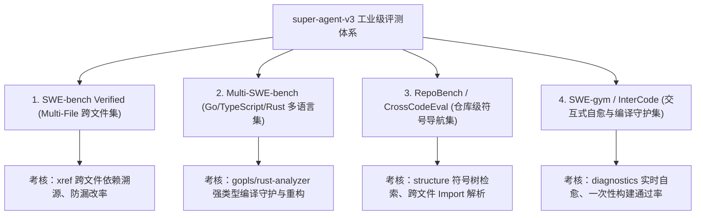

# 4大工业级评测套件与多语言架构契约 (Industrial Evaluation 4-Suites Contract)

## 1. 契约背景与演进决议

本契约正式废弃基于早期 GitHub 单行修补的旧 500 题单文件评测。
传统的微观修补评测存在三大致命缺陷：
1. **单测脆弱与私有实现绑定**：无法反映真实软件工程解法；
2. **对 LSP 重型语义工具的逆淘汰**：单文件单行修改掩盖了 LSP 的跨模块调用追踪和类型守卫优势；
3. **语言单一**：局限于 Python 动态弱类型，无法衡量 Go/Rust/TypeScript 强类型工业场景。

自本契约生效之日起，`super-agent-v3` 全面收敛并切换至 **4 大新一代工业级评测集合**。

---

## 2. 四大工业级评测集合定义与分工

### 套件一：SWE-bench Verified Multi-File（跨文件多模块重构集）
- **规模**：137 题（金标 Patch 跨 $\ge 2$ 个文件）。
- **语言**：Python 大型工业库（Django、SymPy、Pytest、Sphinx、Scikit-learn、Astropy）。
- **考核重点**：`xref` 追踪调用链完整性、Admin/Serializer/Hook 跨模块级联防漏改率、`Root-Cause Minimality` 根因最小作用域原则。

### 套件二：Multi-SWE-bench（多语言强类型工业基准）
- **规模**：约 450 题。
- **语言**：**Go (`gopls`)、TypeScript (`vtsls`)、Rust (`rust-analyzer`)、Python (`pyright/jedi`)**。
- **考核重点**：静态类型系统遵从、接口多态实现、包依赖管理、强类型编译器零报错交付。

### 套件三：RepoBench / CrossCodeEval（仓库级符号检索与导航基准）
- **规模**：约 800 题。
- **考核重点**：十万行级代码库中的 `structure(workspace_symbol)` 召回率、跨文件符号跳转精度、无报错前提下的宏观架构定位。

### 套件四：SWE-gym / InterCode（交互式自愈与编译守护基准）
- **规模**：约 250 题。
- **考核重点**：Agent 与环境的多轮交互效率、`diagnostics` 前置差量行拦截率、自愈轮次（Repair Cycles）经济性。

---

## 3. 核心评估指标矩阵 (Evaluation Metrics)

| 指标名称 | 符号定义 | 达标红线 | 评价意义 |
| :--- | :--- | :---: | :--- |
| **Strict Pass@1** | $\text{Pass Rate}$ | $\ge 75\%$ | 官方隐藏单测一次性绿灯通过率 |
| **跨文件防漏改率** | $\text{Cross-File Recall}$ | $\ge 95\%$ | 关联模块（如 Admin、下游消费方）完整同步率 |
| **差量行静态健康度** | $\text{Diagnostic Zero-Error}$ | $100\%$ | 补丁修改行内 0 语法错误、0 类型不兼容 |
| **多语言平权度** | $\text{Multi-Lang Parity}$ | $\ge 70\%$ | Go、TypeScript、Rust 强类型语言与 Python 表现对齐 |

---

## 4. 执行与验证守卫

1. **禁止回滚**：不得恢复旧 500 题单行盲搜评测作为核心验收门禁；
2. **三工具闭环**：所有 With-LSP 实验必须完整暴露 `structure`、`xref`、`diagnostics`；
3. **差量防噪**：`diagnostics` 必须结合 `git diff -U0` 差量过滤，显式忽略历史未修改行的遗留 Warning。
